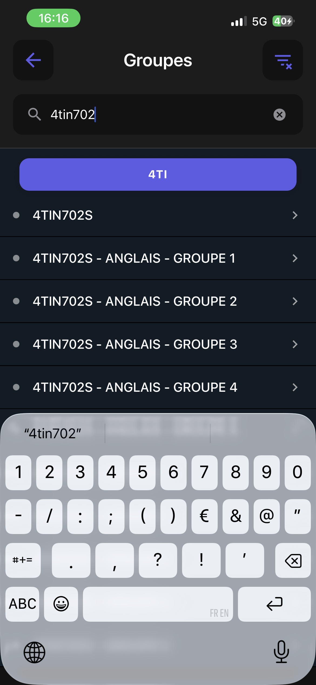
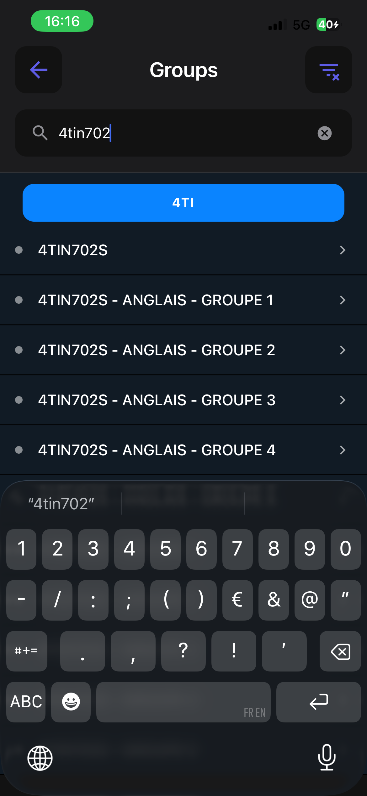

# Défauts fonctionnels connus

Liste **vivante** des défauts de comportement rencontrés en chemin. Ils ne sont pas du goût : ils se
corrigent, se testent et se cochent comme n'importe quel correctif.

> **Pourquoi ce document est séparé de [l'inventaire visuel](inventaire-visuel.md).** L'inventaire est
> une mesure datée qui ne bouge plus ; cette liste-ci se coche et s'allonge. Et surtout : mélanger un
> défaut fonctionnel à de l'esthétique dans une session de refonte rend la session **invérifiable** —
> on ne sait plus dire quand elle est finie, et c'est la moitié facile qui se fait.
>
> Une session d'écran qui rencontre un défaut fonctionnel l'ajoute **ici** et ne le corrige pas au
> passage, sauf s'il tombe exactement dans son périmètre. La règle est écrite dans
> [CONTRIBUTING.md](../CONTRIBUTING.md#un-travail-visuel-nest-pas-documenté-au-même-endroit).

Ouvert par le jalon [6-K](phase-6/6-k-socle-visuel.md) le 2026-08-16. Le jalon les a **inventoriés**
pour qu'aucune session ne les confonde avec du visuel ; ils ont été corrigés dans la foulée, sur
décision du propriétaire du produit — éponger la dette avant d'ouvrir les sessions d'écran plutôt que
de la leur laisser en travers.

## Ouverts

### ~~Un filtre saisi à la main accepte n'importe quel texte, et ses rangées sont décalées~~ — constaté le 2026-11-10, corrigé le même jour

Vu au banc en jouant l'ajout manuel d'un filtre (audit du lot 1, `ukit`, sombre) : « bonjour »
s'enregistrait en filtre « BONJOUR », compté dans la rangée des Réglages, alors qu'un filtre se
compare à des codes d'UE et ne pouvait rien masquer. Refusé désormais, avec la raison sous le champ
et le texte gardé pour qu'on le corrige ; l'écran descend jusqu'à la phrase, que le clavier ouvert
cachait ([`codeDeFiltreSaisi`](../src/features/Planning/services/filtresUe.ts),
[`FiltersScreen`](../src/features/Settings/screens/FiltersScreen.tsx)). Vu au même moment : dans une
rangée de filtre, le code se centrait (`alignSelf` du style partagé `buttonMainText`) au-dessus d'un
intitulé calé à gauche. Calé à gauche lui aussi. Un filtre déjà enregistré qui n'est pas un code reste
où il est, retirable par sa croix : il ne masquait rien, il ne masque toujours rien. Vérifié sur
`ukit` : minuscules remises en majuscules, doublon sans effet, texte libre refusé, ajout par la touche
Entrée du clavier.

### ~~Les boutons de pas du délai des rappels sont des disques~~ — constaté le 2026-11-10, harmonisé le même jour

Vu au banc pendant l'audit du lot 1 : « − » et « + » de la page Notifications étaient ronds, forme que
[CONTRIBUTING](../CONTRIBUTING.md) réserve aux points d'état, aux compteurs et aux jauges (« un bouton
rond dénote »). Harmonisés en carré arrondi de `radius.md`, comme le bouton de retour et le bouton de
filtre ([`SettingsSections`](../src/features/Settings/components/SettingsSections.tsx)) ; la phrase de
[theme.md](theme.md) qui disait le délai choisi « dans une liste cochée » était aussi périmée.

### ~~Dans la recherche de groupes, le premier toucher sur un résultat ne l'ouvre pas~~ — constaté le 2026-11-10, corrigé le même jour

Vu au banc pendant l'audit du lot 1, sur `ukit` : `INF601A1` tapé, le premier toucher sur le résultat
ne faisait que fermer le clavier, et il fallait toucher une seconde fois. La liste n'avait pas
`keyboardShouldPersistTaps`, que l'écran des filtres et l'étape des groupes de l'accueil portent déjà.
Corrigé ([`GroupSelectionScreen`](../src/features/Planning/screens/GroupSelectionScreen.tsx)) ; vérifié
sur `ukit`, clavier ouvert, le planning du groupe s'ouvre au premier toucher.

### ~~Après un changement de langue, le ruban des jours reste dans l'ancienne, et le choix de langue des Réglages traduit les noms de langue~~ — constaté le 2026-11-10, corrigé le même jour

Vu au banc pendant l'audit du lot 1, sur `ukit` : passé en anglais depuis les Réglages, le Planning
gardait « Novembre » et « SAM., DIM. » jusqu'au lancement suivant. Une instance `moment` garde la
locale de sa création, et les jours du ruban sont créés au montage ; les cases ne se redessinaient
pas non plus, la langue n'entrant pas dans leur clé d'apparence. Corrigé : le Planning relocalise
ses jours au changement de langue sans toucher à la sélection
([`DayView.relocaliser`](../src/features/Planning/views/DayView.tsx)), et la locale entre dans la clé
des cases ([`CalendarDay`](../src/features/Planning/components/CalendarDay.tsx)). Vu au même moment :
le choix de langue des Réglages proposait « Anglais », « Espagnol », traduits dans la langue courante,
quand l'accueil écrit chaque langue dans la sienne pour qu'on reconnaisse la sienne ; la table des
autonymes est désormais partagée ([`langues.ts`](../src/shared/i18n/langues.ts)). Vérifié sur `ukit` :
français → anglais → espagnol → français, le ruban suit à chaque fois sans relance.

### Des cours du matin absents le jour même — rapporté deux fois, Android 16, le 2026-09-30

Deux retours : l'un avec un lien d'abonnement collé, l'autre sur Celcat. **Non reproduit** au lot 1,
le 2026-11-10. Essayé sur `ukit-a8` (Android 9) puis `ukit` (Android 15, le plus proche d'Android 16
au banc), en déplaçant l'horloge du **système** et non la seule simulation du menu, pour que
`Date.now()` bouge aussi :

- Celcat, groupe `INF501A1` : la veille au soir, puis saut de nuit l'application en arrière-plan, puis
  12 h 30, puis 13 h 30 réseau coupé (cache du jour) : le cours de 9 h 30 reste affiché à chaque fois,
  « Aujourd'hui » passe au bon jour ;
- lien d'abonnement ADE (`nbWeeks=4`, groupe ENSC 2A), à 14 h : les cours de 8 h et 10 h 20 du jour
  sont là. L'export d'ADE commence bien au début du jour courant (vérifié sur la réponse brute) ;
- minuit passé l'application ouverte : « Aujourd'hui » menait à la veille — défaut réel, corrigé
  (entrée du 2026-11-10), mais il montre la veille entière, pas un jour amputé de son matin.

La lecture du code ne trouve pas de filtre sur l'heure : la journée Celcat se refiltre sur sa date
locale, celle de l'abonnement sur le jour local, et la frise n'efface pas un cours passé, elle
l'estompe. **Ce qu'il faut demander aux deux utilisateurs** : à quelle heure ils regardent ; si les
cours du matin reviennent en tirant l'écran ou en fermant l'application ; une capture de l'écran au
moment où ils manquent ; pour le lien collé, le site qui le fournit (une source qui exporterait « à
partir de maintenant » expliquerait tout et ne serait pas dans UKit) ; et pour les deux, le fuseau
du téléphone (Réglages, Date et heure).

### La liste des groupes est vide sur un Android 8.0 — rapporté le 2026-09-30

Un retour. **Non reproduit** au lot 1, le 2026-11-10, sur `ukit-a8` (Android 9, le plus proche au
banc) : installation neuve, Collège ST, Licence 3 automne, la liste se remplit
(`ukit.celcat.groupes` en 1,2 s). Android 8.0 a un magasin d'autorités plus vieux encore que celui
de l'A8, et c'est la piste la plus probable : les serveurs des facs échouaient déjà en erreur réseau
sur les vieux Android (corrigé le 2026-09-08 en embarquant les racines). Une liste vide **sans
message** contredirait toutefois le correctif du 2026-11-08 (une liste vide se dit). **Ce qu'il faut
demander** : l'écran exact (un message, ou une liste vide sans rien), l'établissement, et si
Campus et la Scolarité répondent sur ce téléphone.

### La position refusée donne des distances comptées depuis Talence, affichées comme vraies — constaté le 2026-11-10

Vu au banc pendant l'audit du lot 1 : localisation refusée, la carte de l'A28 affiche « 360 m ».
C'est une décision écrite ([campus.md](features/campus.md)) — le repli sur le centre de Talence garde
les listes triées et utiles sur un émulateur ou sans permission — mais la distance affichée se lit
comme celle de l'étudiant. **Non corrigé, parce que c'est défaire une décision écrite** : la
correction recommandée garde le tri depuis Talence et retire le badge de distance quand la position
est celle du repli (`PositionResolue.error` existe déjà). Soumis au propriétaire du produit. Vu au
même moment sur `ukit-a8` : le repli n'étant pas gardé, chaque visite du Campus après un refus
redemande la permission, et Android 9 la repose tant que « Ne plus demander » n'est pas coché — à
trancher avec le badge.

### ~~Le titre d'un cours commence parfois par une espace~~ — constaté le 2026-11-10, corrigé le même jour

Vu au banc pendant l'audit du lot 1 : « ␣Histoire et Epistémologie de l'Optimisation ». Celcat sert
parfois deux espaces après le code d'UE (`4TIN606U  Histoire…`, déjà mesuré au jalon 6-K pour les
intitulés des filtres, qui les retiraient), et le titre gardait la seconde. Corrigé à la source :
[`separerCodeUE`](../src/features/Planning/services/PlanningAssembly.ts) rend un reste sans espace en
tête, testé ; la parité reste verte.

### ~~Minuit passé l'application ouverte, « Aujourd'hui » mène à la veille~~ — constaté le 2026-11-10, corrigé le même jour

Joué au banc pendant la recherche des cours du matin absents (audit du lot 1) : horloge du système
avancée au jeudi 7 h 50 avec le Planning au premier plan, « Aujourd'hui » ramenait au mardi. Le jour
courant n'est recalculé qu'au retour au premier plan (correctif du 2026-09-02) ; minuit passé l'écran
allumé, sans aller-retour, ne le recalculait pas. Corrigé : le geste vérifie la date et recalcule
tout s'il le faut ([`DayView.onTodayPress`](../src/features/Planning/views/DayView.tsx)). Vérifié sur
`ukit` : même saut, « Aujourd'hui » charge le jeudi 12 et ses quatre cours.

### ~~Le changement d'établissement annonce effacer les favoris et la session, qu'il garde~~ — constaté le 2026-11-10, corrigé le même jour

Trouvé au banc pendant l'audit du lot 1 : la confirmation disait « Groupes favoris, planning en
cache, session universitaire et cours ajoutés au calendrier seront effacés ». Les favoris, les
filtres et la session sont **rangés** par établissement depuis le 2026-08-22, et reviennent au
retour — vérifié sur `ukit` : Collège ST, puis Bordeaux INP avec son compte, puis retour au Collège
ST, compte « Connecté », deux filtres et le favori retrouvés. Quelqu'un renonçait donc à changer
d'établissement de peur de perdre ce qu'il ne perdait pas. Le texte dit désormais ce qui part (le
planning en cache, les cours de l'agenda) et ce qui reste ; la ligne du tableau de
[settings.md](features/settings.md#changer-détablissement), restée sur l'état d'avant, aussi.

### ~~Les lecteurs d'écran lisent la WebView cachée, des glyphes d'icônes et des boutons muets~~ — constaté le 2026-11-10, corrigé le même jour

Vu dans l'arbre d'accessibilité au banc pendant l'audit du lot 1, sur `ukit` : la WebView d'Aetherius,
transparente et posée par-dessus l'application, y exposait ses pages — le tableau de bord Moodle,
les dossiers de la messagerie — à un lecteur d'écran ; les rangées des Réglages s'annonçaient
« , Langue » ou « , Filtres », le glyphe de la police d'icônes étant lu comme un caractère ; la croix
des dialogues de choix et de la proposition d'UE, et l'œil du mot de passe, étaient des boutons sans
nom. Corrigé : la WebView est enveloppée d'une vue retirée de l'accessibilité, au même endroit
([`rootContainer`](../src/shared/navigation/rootContainer.tsx)) ; une icône de police est un décor
([`Icon`](../src/shared/ui/Icon.tsx)) ; les trois boutons portent leur nom. **La première vérification
était fausse** : elle était tombée sur une page sans contenu. Moodle rechargé, ses nœuds étaient
encore là — la nouvelle architecture aplatissait l'enveloppe, qui ne dessine rien, et son
interdiction avec elle. `collapsable={false}` la garde. Vérifié ensuite sur `ukit` après le dossier,
la messagerie, Moodle et les documents : aucun nœud de la WebView dans l'arbre, « Langue,
Français », et les quatre lectures en succès par la WebView enveloppée. Le passage VoiceOver reste à
faire sur l'iPhone.

### ~~Trois chaînes fautives : un « 2 » en trop en espagnol, une apostrophe parasite, un toast en anglais en dur~~ — constaté le 2026-11-10, corrigé le même jour

Relecture des dictionnaires à l'audit du lot 1 : `HIDDEN_RESULT` en espagnol disait « Hay 12 2
resultados ocultos », `CROUS_MARKET` finissait par une apostrophe typographique dans les trois
langues, et l'échec de lecture des réglages s'affichait « Settings couldn't be loaded » en dur, alors
que la clé traduite existait. Corrigés ; le toast charge le traducteur à la demande, `Translator`
important `AppCore`.

### ~~Un lien d'abonnement et les adresses du navigateur intégré s'écrivent en entier dans le journal de l'appareil~~ — constaté le 2026-11-10, corrigé le même jour

Vu au banc pendant l'audit du lot 1, en collant un lien de travers : `[aetherius] ukit.edt.abonnement
: rejected — Expected HTTP 200, got 400 — https://…` portait le lien d'abonnement entier, qui rend le
planning de quelqu'un sans authentification. Le détail d'un échec http contient l'URL de la requête,
et `reportFailure` l'écrivait tel quel ; deux traces du navigateur intégré écrivaient aussi des
adresses complètes, qui peuvent porter un ticket CAS. La console de production part dans le journal
du système. Corrigé : ces trois lignes ne gardent que l'origine
([`sansAdresses`](../src/shared/utils/journal.ts), testé) ; l'échec garde son détail entier en mémoire
pour le menu de développement.

### ~~Des identifiants que le trousseau refuse d'écrire laissent croire à une connexion durable~~ — constaté le 2026-11-10, corrigé le même jour

Trouvé par la relecture du code de l'audit du lot 1, non reproduit au banc (le trousseau de
l'émulateur ne refuse rien). `saveCredentials` rend `false` quand le magasin sécurisé refuse
l'écriture — un magasin de clés Android corrompu le fait —, et la connexion ne lisait pas ce
résultat : l'étudiant se croyait connecté, et ne l'était plus au lancement suivant, sans un mot.
Corrigé : la session en cours garde les identifiants en mémoire et continue, et un toast dit qu'il
faudra se reconnecter au prochain lancement
([`CredentialsContext`](../src/features/Scolarite/services/CredentialsContext.tsx)). Le dossier non
enregistré, lui, se relit de lui-même : des identifiants sans dossier relancent le parcours froid.

### ~~Après un changement d'établissement, une lecture partie avant peut remettre les groupes ou les bâtiments de l'ancien~~ — constaté le 2026-11-10, corrigé le même jour

Trouvé par la relecture du code de l'audit du lot 1, non reproduit au banc (il faut qu'une lecture
lente croise la bascule). La liste des groupes se vidait bien à la bascule, mais une lecture partie
avant — le rafraîchissement automatique du démarrage — écrivait sa réponse à l'arrivée, dans la
liste du nouvel établissement. Les bâtiments, eux, n'étaient pas vidés du tout en mémoire : la clé
disque était purgée, la liste restait servie jusqu'au lancement suivant. Sans effet visible tant que
tous les établissements partagent le Celcat de Bordeaux ; le lot 3 en ajoute qui ne le partagent
pas. Corrigé : chaque bascule ouvre une génération, une réponse d'une autre génération ne touche plus
à la liste ([`PlanningDataManager`](../src/features/Planning/services/PlanningDataManager.ts),
[`CampusDataManager`](../src/features/Campus/services/CampusDataManager.ts)), et la liste des
bâtiments se vide comme celle des groupes.

### ~~La semaine du 28 décembre 2026 s'affiche à la place d'une semaine de 2028~~ — constaté le 2026-11-10, corrigé le même jour

Trouvé par la relecture du code de l'audit du lot 1. Une semaine du Planning se nommait par son
numéro ISO et son année **civile** : les jours de frontière se trompaient d'année. Le vendredi
1er janvier 2027 est dans la semaine 53 de 2026 ; la liste des semaines l'étiquetait `{ 53, 2027 }`,
et `moment().year(2027).isoWeek(53)` débordait sur janvier 2028 — la vue semaine, la date de repli
des colonnes et l'en-tête du ruban demandaient une semaine inexistante. Et la clé de cache d'une
semaine ne portait pas l'année : hors ligne, la semaine 1 de 2027 aurait resservi celle de 2026
comme d'hier, rappels de l'entretien compris. Corrigé : l'année ISO partout, le lundi calculé depuis
le 4 janvier de son année ([`semaineIsoDe`, `lundiDeSemaineIso`](../src/features/Planning/services/PlanningAssembly.ts),
testés sur chaque semaine d'une année scolaire), l'année dans la clé (`@Week2026-53`). Vérifié sur
`ukit`, horloge au 1er janvier 2027 : « Semaine 53 », colonne du 28 décembre, clé `@Week2026-53`.

### ~~À l'accueil, un groupe cherché par son nom reste introuvable tant que l'année n'est pas choisie~~ — constaté le 2026-11-10, corrigé le même jour

Trouvé au banc pendant l'audit du lot 1, sur `ukit` : `INF501A1` tapé dans la recherche, sans année
choisie, affichait « Aucun groupe ne correspond à cette recherche ». Le tri par année rendait une
liste vide par construction tant que l'année manquait. Mesuré au même moment sur la liste réelle
de Celcat (2 982 groupes), deux défauts de la table de fragments, qui compare des sous-chaînes :
`31ST750U M1 Professionnalisation` paraissait en Licence 3 (`50` dans `750`), sept `M2 … S10` en
Licence 1, et les quatorze `L3 IMSAT S5/S6` n'apparaissaient qu'en « Autre ». Corrigé : une
recherche sans année porte sur toute la liste, et un nom qui écrit son niveau (`L1` à `M2`) et son
semestre (`S5`, `S10`) est rangé par eux avant les fragments
([`groupesProposes`](../src/features/Onboarding/hooks/groupesProposes.ts), testé sur des noms réels).
Un groupe au niveau écrit sans semestre écrit paraît aux deux semestres, comme avant.

### ~~L'échec d'une synchronisation de l'agenda ne dit pas sa raison~~ — rapporté le 2026-09-17, corrigé le 2026-11-10

Deux retours du formulaire, dont un Pixel 6a vers Google Agenda : « la synchronisation a échoué »,
sans rien d'autre, et c'est tout ce que l'écran montrait — la raison n'était lisible que dans le
menu de développement. Trois défauts voisins, trouvés en le corrigeant : un calendrier **en lecture
seule** se laissait choisir et chaque écriture levait une exception native ; le calendrier « UKit »,
une fois créé, était désigné par son identifiant, si bien que le supprimer du téléphone faisait
viser pour toujours un identifiant mort ; et `syncCalendar` n'était pas protégé contre deux
passages parallèles — au banc, après un rechargement à chaud, chaque cours a été écrit deux fois et
la purge n'en a retiré qu'un. Corrigé : la tentative porte une cause que la ligne d'état et le toast
disent en une phrase ; la cible se résout avant toute lecture
([`calendrier/cible.ts`](../src/shared/services/calendrier/cible.ts), testé), un calendrier en
lecture seule n'est plus proposé et est refusé s'il l'est devenu ; « UKit » garde sa valeur
symbolique et se recrée ; un second passage rejoint le premier. Vérifié sur `ukit` avec des
calendriers créés par le fournisseur d'Android : le calendrier en lecture seule absent du choix ;
« Perso banc » passé en lecture seule, puis « Forcer » : « Le calendrier choisi n'accepte pas de
nouveaux événements : choisis-en un autre, ou « UKit » » dans le toast et la ligne d'état ; « UKit »
supprimé du système, puis « Forcer » : recréé avec ses 263 cours. La synchronisation vers un compte
Google réel n'est pas au banc (aucun compte sur l'émulateur) : la cause du Pixel 6a reste à lire
dans sa ligne d'état.

### ~~Les « UE non suivies » s'acceptent en lot et peuvent masquer un vrai cours~~ — rapporté le 2026-09-23, corrigé le 2026-11-10

Deux retours du formulaire (23 septembre, puis des TP absents le 3 novembre) : « Appliquer » posait
en filtre toutes les UE du planning absentes des inscriptions de l'annuaire, et une inscription
pédagogique en retard ou un cours sous deux codes suffisaient à masquer un vrai TP, sans que rien
ne le montre ensuite. Un second défaut, trouvé en le corrigeant : la liste comparée était celle des
UE rencontrées, qui s'accumule sur **tous** les plannings affichés, si bien que consulter le groupe
d'un ami faisait proposer ses UE. Corrigé : chaque UE se coche, rien ne l'est d'office, la raison
est dite en tête ; la comparaison porte sur l'année des favoris
([`PropositionsChoix`](../src/features/Scolarite/services/PropositionsChoix.ts), testé) ; après
l'acceptation, un dialogue dit combien d'UE sont masquées, où les retrouver, et porte « Annuler » ;
la rangée Filtres des Réglages porte leur nombre. Vérifié sur `ukit` avec un compte réel : 21 UE
proposées sans aucune cochée, deux cochées masquées puis visibles dans Filtres (« 2 »), une
troisième posée puis annulée sans toucher aux deux premières.

### ~~À l'accueil, une année sans semestre laisse la liste des groupes vide, sans rien dire~~ — constaté le 2026-11-08, corrigé le 2026-11-10

Collège ST, « Master 1 » touché, aucun semestre : la liste disparaît sous le champ de recherche, et
rien n'indique qu'il manque le semestre. Le semestre en cours est désormais présélectionné, au départ
comme après un changement d'établissement ([`semestreDe`](../src/features/Onboarding/hooks/semestres.ts)).

### ~~Un portail lent s'annonce « Le problème vient de UKit »~~ — constaté le 2026-11-06, corrigé le 2026-11-10

*Corrigé au lot 1 de la [prochaine version](prochaine-version.md) :* un run porte la durée de sa plus
longue navigation, et un `engine` sans code après plus de dix secondes de navigation devient
`unavailable [PORTAIL_LENT]`, « Le portail de ton université met du temps à répondre », réessayable,
pour la session comme pour les widgets — la messagerie lente des deux retours du 29 septembre passe
par le même chemin ([`requalifierLenteur`](../src/features/Scolarite/services/ScolariteMapping.ts),
testé). **Non reproduit au banc** : sous le réseau bridé de l'émulateur (EDGE, latence UMTS), la
navigation vers le CAS n'a pris que 3,2 s et la vérification a réussi ; une seule tentative, pour ne
pas solliciter le portail. Le délai de `wait_for` n'est pas allongé : sans mesure de l'étape qui a
cédé, l'allonger serait deviner.


Au banc, juste après un effacement des données (WebView à froid), la vérification des identifiants à
l'accueil a attendu 12 s le chargement de la page de l'université (« Un moment SVP… »), puis
`ukit.portail.verification` a échoué sur `engine` : la page ne s'est pas déclarée prête dans les 2 s
de `wait_for`. La carte a affiché « Cette opération n'a pas pu aboutir. Le problème vient de UKit. »,
alors que c'est le portail qui traînait. Un second essai a réussi. À trancher : le délai de
`wait_for` après une navigation lente, et la cause annoncée (un échec `engine` après une navigation
qui a pris plus de 10 s se lit plutôt comme un portail lent).

### ~~La liste des groupes de l'accueil passe sous le bouton « Suivant »~~ — constaté le 2026-11-06, corrigé le 2026-11-07

À l'étape des groupes (Master 1, automne, Collège ST), les pastilles de la liste continuent sous le
bouton flottant et sous la pagination, sans dégagement ni fondu : la dernière rangée se lit à travers
le bouton. Corrigé avec l'accueil refait : le pied pose un fondu de la couleur de la page, sous
lequel le contenu s'efface ([`WelcomeScreen`](../src/features/Onboarding/WelcomeScreen.tsx)).

### ~~Un cours sans heure de fin s'écrit « Invalid date »~~ — constaté le 2026-11-05, corrigé le 2026-11-06

Sur le banc, le groupe `31BI701S` (stage du jeudi 5 novembre) : Celcat sert l'événement « Stage » avec
une fin nulle, et la projection en faisait `endtime: 'Invalid date'`, la forme du code d'origine. La
carte de cours le taisait déjà, mais la fiche, le créneau composé et les rappels le lisaient. Une
heure illisible s'écrit désormais vide, et le créneau ne garde pas de tiret orphelin
([`heureOuVide`, `creneauCompose`](../src/features/Planning/services/PlanningApiMapping.ts), testés),
dans la projection Celcat comme dans l'iCal. La fonction commune du harnais de parité suit la même
règle des deux côtés : la parité Celcat reste égale.

### ~~« Ouvrir sur le groupe favori » n'a aucun effet~~ — constaté le 2026-11-06, retiré le même jour

Le réglage s'enregistrait et se relisait au démarrage
([`AppCore`](../src/shared/services/AppCore.tsx)), mais rien ne le lisait pour décider de l'écran
d'ouverture : l'application s'ouvre de toute façon sur le Planning des favoris. Le propriétaire du
produit a choisi de le retirer plutôt que de le rebrancher ; la page Démarrage des Réglages part
avec lui, et la clé `openAppOnFavoriteGroup` n'est plus écrite (une valeur déjà enregistrée reste
dans le fichier, sans lecteur).

### ~~Les touchers juste au-dessus de la barre d'onglets ne répondent pas~~ — constaté le 2026-11-05, corrigé le même jour

*Corrigé pendant la deuxième passe de 7-J, qu'il bloquait :* le conteneur de la barre d'onglets
([`MainTabNavigator`](../src/shared/navigation/MainTabNavigator.tsx)) monte de `VOILE_PIED` (32 points)
au-dessus de la barre pour porter sa fumée, et ce rembourrage transparent avalait les touchers. Sur le
tableau Campus, l'étoile et le titre d'une carte posés dans cette bande ne répondaient pas. Présent
depuis le 2026-08-30, donc en 6.0 et 6.1. Le conteneur passe en `pointerEvents="box-none"` : ses
enfants (onglets, bouton de verrou) restent touchables, et le glissement entre onglets passe toujours.
Vérifié sur `ukit` : l'étoile répond, les onglets aussi, le glissement change d'onglet.

### ~~Le menu de développement s'ouvre en partie hors de l'écran~~ — constaté le 2026-11-05, corrigé le même jour

*Corrigé pendant le plan de test du 7-I, qu'il bloquait :* le panneau de
[`ModMenu`](../src/shared/ui/ModMenu.tsx) s'ouvrait à la position de sa bulle (`largeur - 80`) avec sa
largeur de 300, et la borne n'était appliquée qu'au relâcher d'un glissement. Il débordait à 360 points
comme à 411 (`ukit`), boutons de repli et de fermeture compris. La même borne s'applique désormais à
l'ouverture. Vérifié sur `ukit` : le panneau s'ouvre entier, ses deux boutons à portée.

### ~~Le parcours d'accueil s'ouvre en anglais sur un Android en français~~ — constaté le 2026-11-04, corrigé le 2026-11-05

*Corrigé par [7-J](phase-7/7-j-ecrans.md) :* la langue du système se lit désormais par `getConstants()`
d'abord, puis par les propriétés historiques, puis par la locale qu'`Intl` tient du système
([`langueDuSysteme`](../src/shared/i18n/langueDuSysteme.ts) ; le choix, pur, dans
[`langues.ts`](../src/shared/i18n/langues.ts), testé). Vérifié sur le banc le 2026-11-05, installation
neuve sur `ukit` (Android 15, `fr-FR`) : « Bienvenue ! », « Commencer ». La branche iOS lit
`SettingsManager` de la même façon, par `getConstants()` d'abord ; elle se vérifie sur l'iPhone.


Sur le banc Android (Android 9, système en `fr-FR`), une installation neuve ouvre le parcours en
anglais, « English » présélectionné, alors que [onboarding.md](features/onboarding.md) promet la
langue du téléphone. La cause est mesurée par un journal posé dans
[`deviceLanguage()`](../src/shared/services/AppCore.tsx) : sous la nouvelle architecture,
`NativeModules.I18nManager` n'expose plus que `getConstants()`, `localeIdentifier` vaut `undefined`,
et la fonction retombe sur `'en_US'`. Tout nouvel utilisateur Android est touché ; les appareils déjà
installés gardent la langue choisie. La branche iOS lit `NativeModules.SettingsManager` de la même
façon et a sans doute le même défaut, non vérifié faute de simulateur.

### ~~La barre d'état est invisible au premier lancement en sombre, sur Android~~ — constaté le 2026-11-04, corrigé le 2026-11-05

*Cause établie et corrigée par [7-J](phase-7/7-j-ecrans.md) :* React joue les effets des enfants avant
ceux du parent. Au premier lancement, l'accueil pose le thème du téléphone (`setTheme`) avant que le
conteneur racine ne s'abonne à l'événement `theme` : l'événement se perdait, la racine restait en clair
sous un accueil qui lit le thème lui-même, et la barre de statut, rendue par la racine, gardait ses
icônes sombres. Tracé sur le banc (journal du style posé : `dark-content` seulement), puis mesuré par
`dumpsys window` (`apr=LIGHT_STATUS_BARS`). La racine relit désormais le thème et la langue au moment
de s'abonner ([`rootContainer`](../src/shared/navigation/rootContainer.tsx)). Vérifié sur `ukit`,
installation neuve en sombre : plus de `LIGHT_STATUS_BARS`, l'heure blanche. Le défaut ne tenait pas à
Android 9, il se reproduisait sur Android 15. Revu sur `ukit-a8` (Android 9) le même jour, installation
neuve en sombre : l'heure blanche sur `#0B0B12`.

### ~~La réinitialisation laisse la dernière page du navigateur caché en mémoire~~ — constaté le 2026-11-05, corrigé le 2026-11-06

Juste après « Réinitialiser l'application », l'arbre d'accessibilité listait encore la boîte de
réception de l'ENT du compte effacé, dans la WebView cachée d'Aetherius
([`AetheriusWebView`](../src/shared/navigation/rootContainer.tsx)) : la réinitialisation des Réglages
n'effaçait que le local, sans arrêter la session ni fermer le ticket CAS. Elle emprunte désormais le
chemin de la déconnexion du compte quand un compte est connecté
([`SettingsScreen.resetApp`](../src/features/Settings/screens/SettingsScreen.tsx)) : session et
widgets arrêtés, trousseau effacé, ticket CAS fermé côté serveur, ce qui ramène la vue cachée sur la
page de connexion du portail. Vérifié sur `ukit` : `ukit.portail.deconnexion success` au journal,
aucun nœud de messagerie après, la vue cachée sur « Connexion - Université de Bordeaux ». La
réinitialisation complète du menu de développement recharge l'application, ce qui détruit la vue.

### La barre de navigation d'Android 9 reste claire sous l'application sombre — constaté le 2026-11-05

*Lot 1, 2026-11-10 — reste ouvert, par décision.* La correction demande une dépendance native
(`expo-navigation-bar`) et un build de développement puis de production ; ce lot n'en lance aucun.
Elle se fera avec le prochain build natif, comme décidé le 2026-11-06.

Sur `ukit-a8` (Android 9, trois boutons), la barre de navigation du système garde son gris clair
(`#E6E6E6` mesuré) quand l'application est en sombre ; sur Android 15, en navigation par gestes, elle
est transparente. **Ce n'est pas une régression** : la capture « avant » de 7-J mesure la même teinte.
L'application ne règle que la barre d'état ; la barre de navigation se règle en natif
(`androidNavigationBar` de la configuration Expo, ou `expo-navigation-bar` pour la suivre au
changement de thème), donc avec le prochain build de développement. Le Galaxy A8 est le premier
concerné. **Décision du 2026-11-06** : pas dans la 6.3. Le corriger demande une dépendance native et
deux builds pour un défaut d'apparence des seuls Android à trois boutons ; il se fera avec le
prochain build natif, par `expo-navigation-bar` qui suit le thème.


Sur le banc Android (Android 9), installation neuve (`pm clear`), système en sombre : l'accueil se
rend en sombre, comme promis, mais la barre d'état est noire sur noir. La capture n'y compte qu'une
couleur, alors que l'heure est bien dans l'arbre d'écran. Toucher « Clair » puis « Sombre » dans le
parcours la fait réapparaître, icônes blanches. Seul l'état initial est donc faux ; la cause n'est pas
établie ([`StatusBar`](../src/shared/ui/AppUI.tsx) lit `themeName` du contexte racine, et
`androidStatusBar` impose `light-content` dans [`app.config.ts`](../app.config.ts)). À confirmer
sur l'A8 avant la correction.

### Le parcours froid de l'INP dépasse ses attentes sur un appareil lent — mesuré le 2026-09-21

*Lot 1, 2026-11-10 — reste ouvert, faute d'appareil lent.* Sur `ukit`, le même compte se connecte
en 15,9 s (vérification) puis 31,1 s (dossier) : l'émulateur tourne sur seize cœurs et ne reproduit
pas la lenteur de l'A8. Allonger les attentes du Blueprint sans mesure serait deviner ; le Blueprint
est embarqué et publié, donc un délai changé ici demanderait aussi une publication. La
requalification `PORTAIL_LENT` du lot 1 ne touche **pas** ces deux échecs : elle ne vise qu'un
`engine` sans code, et ceux de l'A8 étaient `blocked [CAS_INDISPONIBLE]` (« Le portail de
l'université ne répond pas », réessayable) et `unavailable`. Reste à mesurer sur l'A8 réel, au
protocole de sortie : la durée de chaque étape du dossier (`[chrono]`), et si 30 s → 45 s suffit.

Sur le Galaxy A8 (Android 9) derrière un partage de connexion 5G, la connexion à Bordeaux INP échoue
trois fois de suite, de deux façons : `blocked [CAS_INDISPONIBLE]`, le champ `#username` ou le
dossier n'apparaissant pas en 20 s, puis `unavailable`, la page du dossier ne finissant pas de charger
en 30 s. Le même run passe sur l'iPhone 13 Pro au second essai, et sur l'A8 la messagerie de l'INP
réussit en 10,9 s, les portes ENT et Moodle s'ouvrent, la session CAS est reconnue : ni la WebView,
ni le réseau, ni les certificats ECC de l'INP (racine HARICA 2021, embarquée depuis la 6.2.0) ne sont
en cause. La cause est le dossier lui-même, une application GWT lourde — 2,3 s à 2,8 s par vue depuis
un poste filaire, parcours froid de 25 s ([6.1-D](phase-6/6-1-d-publication.md)) — que ses attentes,
calées sur un iPhone, ne couvrent pas sur un appareil lent. Rien dans le code n'a changé depuis la
6.2.1 sur ce chemin. À reprendre au lot Scolarité de [7-J](phase-7/7-j-ecrans.md) : dire « le portail
met du temps » plutôt que « CAS indisponible », et mesurer sur l'A8 si un délai plus long suffit.

### L'emploi du temps nominatif du premier semestre de L1 n'est pas porté — constaté le 2026-09-07, relevé le 2026-09-21

*Lot 1, 2026-11-10 — reste ouvert, faute de compte.* Aucun compte de L1 n'est dans le `.env` ; rien
ne se construit à l'aveugle.

Deux retours le disent, et le propriétaire du produit le confirme : au Collège Sciences et
Technologies, le premier semestre de L1 n'a pas d'emploi du temps **par groupe** — il est
**nominatif**, servi par Celcat une fois connecté avec les identifiants de l'ENT. L'application, qui
ne connaît que les groupes, montre « Journée libre » à ces étudiants. Mesuré le 2026-09-21 : les
scripts de `celcat.u-bordeaux.fr/calendar` ne connaissent que `GetCalendarData` et ses filtres,
**aucun export iCalendar** — le chemin universel du lien collé ([6-J](phase-6/6-j-compte-et-sources-par-etablissement.md))
ne s'applique donc pas. La lecture demande une session authentifiée sur Celcat, c'est-à-dire un
Blueprint de portail, et pour l'écrire **un compte prêté de L1** ([adaptation-campus.md](adaptation-campus.md)) :
rien ne se construit à l'aveugle. Sans compte, la limite s'écrit : le premier semestre de L1 attend.

### Un étudiant de Bordeaux INP sans emploi du temps personnel, sans que rien ne le dise — rapporté le 2026-09-21

*Lot 1, 2026-11-10 — reste ouvert, faute du cas.* Le compte prêté de l'INP lit son emploi du temps
(ressource lue, proposée, appliquée, planning affiché en 0,8 s) : l'absence ne se reproduit pas. Dire
l'absence demande un écran qui n'existe pas — une rangée « emploi du temps personnel introuvable »
avec sa relance, à placer dans la Scolarité — donc une décision de design, soumise au propriétaire du
produit. À obtenir de l'étudiant concerné : son école et son année, et s'il voit son emploi du temps
dans ADE en se connectant lui-même.

Rapporté par le relais de l'INP : le parcours froid d'un étudiant se joue **sans erreur**, mais son
emploi du temps personnel n'est proposé nulle part ; tous les autres étudiants de l'INP l'ont. Sans
journal ni identifiants, une seule hypothèse tient, et elle est écrite dans le Blueprint lui-même
([`ukit-portail-bordeaux-inp-dossier`](../blueprints/portails/ukit-portail-bordeaux-inp-dossier.blueprint.json),
pas `planning`) : la ressource ADE de l'étudiant est lue dans un arbre GWT après une **pause de six
secondes**, et quand l'arbre n'est pas rendu à temps — ou ne présélectionne pas sa fiche —,
`edt_ressource` revient vide et **le run se déclare réussi quand même** : l'application cesse de
proposer l'emploi du temps personnel sans que rien ne le dise. Deux gestes : demander à l'étudiant de
se déconnecter puis se reconnecter sur une bonne connexion, et s'il manque encore, son école et son
année ; et, au lot Scolarité de [7-J](phase-7/7-j-ecrans.md), **dire l'absence** — une rangée « emploi
du temps personnel introuvable » avec sa relance — plutôt que de se taire.

### ~~« Journée libre » tout le semestre quand le groupe favori n'a plus de cours~~ — rapporté le 2026-09-17, corrigé le 2026-11-10

*Corrigé au lot 1 de la [prochaine version](prochaine-version.md) :* sur une journée de semaine vide
des favoris, l'année des favoris est lue une fois et, sans aucun cours quatre semaines avant ni
après, l'écran dit « Rien depuis des semaines » et mène à la liste des groupes
([`groupeInactif`](../src/features/Planning/services/groupeInactif.ts), testé ;
[planning.md](features/planning.md#une-journée-vide-nest-pas-toujours-une-journée-libre)). Vérifié
sur `ukit` en avançant l'horloge du système au 15 juillet 2027 : l'état et son bouton, après un seul
`ukit.celcat.annee` ; le 11 novembre, férié, reste « Journée libre ».


Un retour d'un utilisateur de l'an dernier : « le planning affiche journée libre tout le semestre ».
Son groupe favori est celui de l'année passée ; à la rentrée, Celcat en publie de nouveaux, et
l'ancien ne porte plus rien. L'application ne distingue pas une journée réellement libre d'un groupe
qui n'a **aucun cours sur des semaines** : elle montre le même état. À faire aux états vides de la
6.3 ([7-I](phase-7/7-i-releve-et-vocabulaire.md), la voix éditoriale) : quand aucun cours n'existe sur
la fenêtre déjà lue, dire « ton groupe a peut-être changé » et mener à la recherche de groupes.

### ~~Un bâtiment dont l'occupation échoue s'affiche entièrement libre~~ — constaté le 2026-09-21, corrigé le 2026-11-10

*Corrigé au lot 1 de la [prochaine version](prochaine-version.md) :* la lecture rend son échec avec
les salles ([`OccupationService`](../src/features/Campus/services/OccupationService.ts)), et un lot
sans aucune salle lue devient l'écran d'échec de la source, avec « Réessayer »
([`aucuneSalleLue`](../src/features/Campus/services/occupationCache.ts), testé). Une salle isolée en
échec reste comptée libre. Vérifié sur `ukit` : réseau coupé, la fiche de l'A28 dit « Service
indisponible » ; réseau rendu, « Réessayer » rend les créneaux.


Trouvé en jouant le protocole du disjoncteur de [7-C](phase-7/7-c-economie-et-socle.md), réseau coupé
par l'interrupteur HORS LIGNE : la fiche de l'A28 s'ouvre normalement et **toutes ses salles sont
libres**, alors que ses dix-sept lectures d'occupation viennent d'échouer en six millisecondes chacune.
Rien ne dit la panne.

La cause est une règle d'avant le jalon, écrite dans
[`useFreeRoomsData.ts`](../src/features/Campus/FreeRoom/hooks/useFreeRoomsData.ts) : une salle dont
la lecture échoue est comptée sans événement, donc libre — « chaque échec reste isolé et ne vide pas
tout le bâtiment ». Juste pour une salle sur dix-sept ; faux quand toutes échouent, où un écran vide
serait plus honnête qu'un bâtiment libre. Le cache de 7-C ne mémorise pas un lot entièrement en échec
(`estCachable`, [`occupationCache.ts`](../src/features/Campus/services/occupationCache.ts)), donc la
fiche redemande à l'ouverture suivante ; mais elle continue de montrer des salles libres pendant la
panne. À corriger avec l'écran des salles libres de la 6.3 ([7-J](phase-7/7-j-ecrans.md)) : un lot
sans aucune salle lue devient l'écran d'échec de la source, et une salle isolée en échec reste comptée
libre.

*Le 2026-09-27, avec la requête groupée de [7-I](phase-7/7-i-releve-et-vocabulaire.md#décisions-du-2026-09-26)* :
la fiche joue un seul run pour tout le bâtiment, et son échec est **tout ou rien**. Le cas entier
devient le seul cas ordinaire — une salle isolée en échec ne se voit plus qu'au rejeu d'une salle
absente du cache, dans sa fenêtre de dix minutes. Le défaut et son correctif ne changent pas
([campus-salles-libres.md](features/campus-salles-libres.md#limites-connues)).

### Les intitulés de cours d'un iCalendar collé sont parfois bizarres — constaté le 2026-09-16

*Lot 1, 2026-11-10 — reste ouvert, faute d'exemples.* La source qui l'a montré est PRONOTE, chez
Bordeaux Montaigne, dont le compte prêté appartient au lot 3 : le lien s'y lira, et ses `SUMMARY`,
`DESCRIPTION` et `LOCATION` réels avec lui. Les corriger avant serait régler la projection sur un
émetteur imaginé.

Trouvé en vérifiant le lien d'abonnement de **Bordeaux Montaigne**, servi par PRONOTE Campus, collé
dans « Mon université n'est pas dans la liste » ([7-B lot 1](phase-7/7-b-nouveaux-campus.md)). Le
planning **s'affiche et les cours sont les bons** — le chemin universel de
[6-J](phase-6/6-j-compte-et-sources-par-etablissement.md) fonctionne —, mais certains libellés sont
mal découpés.

La cause n'est pas dans le lien, elle est dans la **projection** : tout
[`IcsMapping.ts`](../src/features/Planning/services/IcsMapping.ts) a été réglé le 2026-08-15 sur
**l'export ADE de Bordeaux INP**, le seul émetteur d'iCalendar que le projet connaissait alors. Quatre
de ses règles sont des conventions de cette source, et non de la RFC 5545 :

| La règle | Ce qu'elle suppose | Ce qui arrive avec PRONOTE |
|---|---|---|
| `CODE_MODULE`, `/^[A-Z]{3}\d-[A-Z0-9]{5}$/` | un code de module ADE (`COG7-CILAN`), **seule ancre** de la description | aucune correspondance : `typeDuCours` rend `''`, la pastille CM/TD/TP disparaît et le créneau perd son suffixe |
| `HORODATAGE`, `/^\(Exporté le\s*:/` | le pied de page qu'ADE ajoute | un pied de page d'un autre émetteur n'est pas retiré et s'affiche |
| `lignesUtiles` écarte les lignes égales au sujet **ou à la catégorie** | que la catégorie est connue | catégorie vide, donc plus rien n'est écarté : la description peut **répéter le titre** |
| `SALLES_PAR_DEFAUT`, `motif: '([A-Z][0-9]+)'` ([`socle.ts`](../src/shared/etablissements/socle.ts)) | un code de bâtiment bordelais (`A28`) | la salle ne se reconnaît pas : pas de bâtiment, donc **pas de carte** sur la fiche du cours |

Et le titre lui-même, `subject`, est le **`SUMMARY` verbatim** : si l'émetteur y empile le cours,
le groupe et l'enseignant, l'écran le montre tel quel. C'est un choix délibéré — inventer un
découpage par source serait exactement ce que le lien universel refuse de faire.

**Ce n'est donc pas un défaut du campus, mais le coût de l'universalité** : la projection est réglée
sur un émetteur et en rencontre un second. Deux réponses possibles, à trancher quand ce sera le
sujet — rendre les ancres tolérantes (un code de module générique, un horodatage reconnu par sa
forme), ou porter ces conventions en **données de catalogue**, comme `FormatSalles` l'est déjà depuis
[6-I](phase-6/6-i-planning-universel.md). La seconde est cohérente avec tout le reste du projet et ne
demande aucune release ; elle suppose en revanche une ligne de catalogue, que le campus « autre » n'a
par construction pas.

**Ne se corrige pas au passage** : il faut des exemples réels de `SUMMARY`, `DESCRIPTION` et
`LOCATION` sous les yeux, et une source de test qui n'est pas le calendrier personnel de quelqu'un.

### ~~Les boutons d'en-tête sont invisibles dans Groupes et le planning d'un groupe sur un Android 9~~ — corrigé le 2026-09-11

Mesuré par le propriétaire du produit sur un Galaxy A8 de 2018, dans les deux thèmes ; nulle part
ailleurs. Les deux écrans sont les deux seuls dont le bandeau collant opaque portait une ombre à
`elevation: 2` **sous un en-tête de navigation transparent** — la pile rend cet en-tête dans la carte,
à `zIndex: 1` et sans elevation, et sur ce HWUI l'enfant élevé passe devant. Les bandeaux jumeaux
sans ombre (CROUS, BU, salles libres) fonctionnaient ; le Planning principal a le même bandeau mais
aucun en-tête de pile derrière. Corrigé à la racine : plus aucune `elevation` dans l'application,
toute ombre Android est un `boxShadow` résolu par plateforme ([theme.md](theme.md#les-décisions-durables)),
ce qui dose au passage les ombres Android comme celles d'iOS.

### ~~L'agenda synchronisé ignore les filtres d'UE~~ — corrigé le 2026-09-11

Signalé par le formulaire, vérifié le 2026-09-11. `syncCalendar` passait l'année entière à
l'écriture sans consulter les filtres, alors que l'écran et les rappels de l'entretien les
appliquaient. Corrigé par
[`coursASynchroniser`](../src/features/Planning/services/filtresUe.ts) — sans `poserLesUE`, qui
mute le sujet dont l'agenda fait son titre —, une origine d'entretien `filtres` pour que l'agenda
suive un filtre qui change, et la même règle pour les rappels reprogrammés depuis les Réglages
([settings.md](features/settings.md#les-filtres-due)).

### ~~Les serveurs des facs échouent en erreur réseau sur les vieux Android~~ — corrigé le 2026-09-08, vérifié en production le 2026-09-11

Trouvé la veille de la sortie de la 6.2.0, sur un Galaxy A8 de 2018 : Celcat, les salles libres,
l'ENT, Moodle, le webmail et Apogée tombaient ensemble en erreur réseau, pendant que le CROUS,
Affluences et la base répondaient. Les serveurs des deux facs remontent aux racines HARICA de 2021,
qu'un Android dont l'image système est antérieure à mi-2021 ne connaît pas — son magasin
d'autorités ne se met à jour qu'avec le système. Le greffon
[`autorites-universitaires`](../tools/expo/autorites-universitaires.js) embarque les deux racines
dans la configuration de sécurité réseau, en gardant celles du système
([plateforme.md](plateforme.md#les-racines-de-certification-des-universités)). Ne vaut que pour un
build : sous Expo Go, le binaire n'est pas le nôtre. Défaut antérieur à la 6.2.0.

### ~~La permission de notification n'était jamais demandée~~ — corrigé le 2026-09-08, vérifié en production le 2026-09-11

Les deux interrupteurs de notification sont actifs par défaut, et aucun code ne demandait la
permission tant qu'on n'en touchait pas un : qui n'avait jamais joué avec ne recevait **aucun
rappel de cours**, depuis toujours. Trouvé en jouant le protocole push de
[6.1.x-E](phase-6/6-1-x-e-notifications-push.md). L'entretien la demande une fois, quand elle n'a
jamais été demandée, jamais pendant l'accueil et jamais après un refus ; en production, sur les deux
plateformes, l'invite paraît à la première ouverture après l'installation comme après la mise à jour.

### ~~Lire la page d'engagement depuis le formulaire le fait recommencer~~ — corrigé le 2026-09-07

Rencontré par le propriétaire du produit le jour de la mise en ligne de la page d'engagement
([6.1.x-C](phase-6/6-1-x-c-retours.md)). Le formulaire de retours s'ouvre dans le navigateur
intégré, qui charge tout lien `http(s)` dans la même vue : le lien remplaçait le formulaire, et
« retour » rechargeait Google Forms, qui repart de zéro.

Les trois appelants du formulaire posent désormais des **domaines internes** sur la route
`WebBrowser` ([`liensDuFormulaire.ts`](../src/shared/navigation/liensDuFormulaire.ts)) : ce qui
est chez Google reste dans la vue, tout autre lien s'ouvre par-dessus, dans une seconde instance de
l'écran — le formulaire reste monté en dessous, et « retour » le retrouve tel quel. Par
domaines et non par type de navigation, parce qu'Android ne distingue pas un clic d'une
redirection. Les portails ne posent pas ce paramètre.

**Le défaut est revenu, et deux fois, pour deux raisons que la première correction ne pouvait pas
voir** (mesuré le 2026-09-08 sur iPhone et sur Android) :

1. **Google Forms n'écrit jamais l'adresse du lien.** Il la remplace par
   `https://www.google.com/url?q=<adresse>`, qui est chez `google.com` — donc « interne » pour une
   règle qui ne lit que l'hôte. La vue du formulaire naviguait vers le redirecteur, qui la renvoyait
   aussitôt dehors : le formulaire était perdu **avant** que la règle ait eu son mot à dire.
   `destinationReelle()` défait le redirecteur, et c'est la destination qui est jugée. Un seul saut,
   et seulement chez Google : deviner qu'une adresse quelconque en enveloppe une autre ouvrirait la
   porte à des redirections imaginées.
2. **Android confiait les liens du formulaire au navigateur du système**, et il a fallu deux gestes
   pour l'en empêcher. Google Forms pose ses liens en `target="_blank"` ; avec le défaut de
   `setSupportMultipleWindows` (`true`), la WebView d'Android ne les charge pas elle-même. Le
   formulaire passe donc à `false`, ce qui ramène le lien dans `onShouldStartLoadWithRequest` où la
   règle décide. **Ça n'a pas suffi**, et la lecture du code natif dit pourquoi : quand
   `onOpenWindow` n'est pas fourni, `RNCWebChromeClient.onCreateWindow` fabrique pour la nouvelle
   fenêtre une vue **sans client**, et une vue sans client délègue l'adresse au navigateur du
   système. Or ce gestionnaire n'était posé que sur le formulaire. Il l'est maintenant sur **tous**
   les écrans : sans domaines internes, une nouvelle fenêtre s'ouvre par-dessus, dans une seconde
   instance de l'écran. Les portails y gagnent au passage — une déconnexion CAS ou un PDF partait
   lui aussi dans le navigateur du système, en abandonnant la session.

Et une troisième cause, indépendante des deux autres : la pile **détachait** la vue du dessous quand
le navigateur s'ouvrait par-dessus lui-même, ce qui vide une WebView. L'écran `WebBrowser` pose
`detachPreviousScreen: false` ([`StackNavigator.tsx`](../src/shared/navigation/StackNavigator.tsx)).

Les deux suivants ont été **rencontrés** par la session d'écran Scolarité du 2026-08-25, et
volontairement **pas corrigés** : ni l'un ni l'autre ne tombe dans son périmètre, et les traiter en
passant aurait rendu la session invérifiable
([CONTRIBUTING.md](../CONTRIBUTING.md#un-travail-visuel-nest-pas-documenté-au-même-endroit)).

### ~~La date du bloc de salutation est en français, en dur~~ — corrigé le 2026-08-28

`GreetingBlock` portait ses propres tableaux `DAYS` et `MONTHS` en français et composait
« Bonjour »/« Bonsoir » hors de `Translator` : un utilisateur anglophone lisait « Lundi 25 août » sous
une interface traduite.

La date passe par `moment().format('dddd D MMMM')`, donc par la locale que `Translator` pose déjà. Et
la salutation elle-même n'est plus une condition dans un composant mais une **table de règles**
(`features/Scolarite/salutations/`), dont le socle est traduit comme le reste — voir
[La salutation](features/scolarite.md#la-salutation-est-une-règle-pas-une-condition).

Le format de date change, donc le rendu de référence de ce bloc change : c'était la raison qui
retenait le correctif, et elle a été levée en même temps que le bloc était repris de fond en comble.

### ~~Deux écrans poussés démarrent sous la barre de navigation~~ — corrigé le 2026-08-29

`LienEdtScreen` et `DocumentsScreen` posaient leur contenu à `insets.top` seulement, alors que
l'en-tête de l'application est **transparent** et que le contenu glisse dessous : le titre et l'icône
du formulaire se chevauchaient. Deux causes distinctes, et il valait mieux les nommer :

- `LienEdtForm` ajoutait son propre espacement à une valeur qui ne comptait que l'encoche. Il est
  partagé avec le parcours d'accueil, qui n'a **pas** d'en-tête — c'est donc à l'appelant de savoir,
  et la marge lui est désormais passée déjà calculée (`HEADER_OFFSET` pour l'écran, `space.md` pour
  l'accueil) ;
- `DocumentsScreen` traitait `headerPadding` comme un nombre. `withStaticHeader` rend un **objet de
  style** `{ paddingTop, paddingBottom }` : posé dans `paddingTop`, il était ignoré. Il s'étale
  maintenant dans le style, comme le font `AboutScreen` et `CourseScreen`.

La leçon vaut pour le prochain écran poussé : `HEADER_OFFSET` est la seule valeur juste, et
`withStaticHeader` la donne déjà — encore faut-il l'appliquer telle qu'elle est rendue.

### ~~Le bouton de filtre était agrandi de 14 % en permanence~~ — corrigé le 2026-08-29

`NavBarHelper` animait les boutons d'en-tête par une mise à l'échelle `1.14 → 1` au défilement. La
décision de retirer ce rétrécissement avait été prise, mais elle n'avait été appliquée qu'à moitié :
[`useCampusListHeader`](../src/features/Campus/components/hooks/useCampusListHeader.tsx) posait son
propre `headerRight` — qui **remplace** celui de `NavBarHelper` — et en gardait une copie dont le repli
était la **valeur statique 1,14**.

Le bouton de filtre des écrans Campus restait donc agrandi de 14 %, seul de sa barre, sans jamais
s'animer. La mécanique est retirée des deux endroits ; il ne reste que le cadre de hauteur fixe qui
aligne les boutons sur le titre.

La leçon : un `navigation.setOptions({ headerRight })` **écrase** l'habillage de `NavBarHelper`. Ce
qui y est recopié doit être retiré au même moment que l'original, sinon la copie survit à l'intention.

### ~~Le logo d'établissement ne s'est jamais affiché~~ — corrigé le 2026-08-29

Les fichiers étaient bien dans le bucket (`media/etablissements/*.webp`, servis en 200), le socle
portait l'adresse, et l'écran de connexion montrait pourtant **l'icône de repli** depuis le jour de la
publication.

La cause est la règle du catalogue elle-même : **une ligne publiée remplace, elle ne corrige pas**
(`projeterEtablissement`). `logo_url` valait `null` dans les lignes publiées, donc l'adresse du socle
était effacée au premier rafraîchissement — et le repli faisait son travail, silencieusement.

Le piège est propre à cette règle, et il vaut pour toute colonne : **oublier une colonne dans une
ligne publiée ne laisse pas la valeur d'avant, elle la supprime.** Une ligne de catalogue s'écrit
entière, ce que `supabase/etablissements.sql` disait déjà — il fallait l'appliquer.

### ~~Les quatre toasts de l'application étaient muets~~ — corrigé le 2026-08-29

`react-native-root-toast` déclare `RootSiblingParent` **obligatoire au-dessus de React Native 0.62**,
et l'application est en 0.81. L'enveloppe était absente de `App.tsx` : `Toast.show` ne levait pas, il
ne rendait simplement rien.

Trois des quatre messages concernés annoncent un **échec** — un document qu'on n'a pas pu ajouter, des
réglages illisibles, une absence de réseau. Ils n'ont donc jamais été vus. Trouvé en cherchant pourquoi
la confirmation de copie de l'écran du compte ne s'affichait pas.

La confirmation de copie, elle, ne repasse **pas** par un toast : même réparé, il apparaît en bas de
l'écran, loin du doigt, et derrière la barre d'onglets flottante. L'icône devient une coche verte —
là où l'œil est déjà.

### ~~Les boutons d'en-tête avaient cinq tailles~~ — corrigé le 2026-08-29

Le bouton retour valait 50 × 50 avec une icône de 28, les quatre autres 45 × 45 avec des icônes de 24
ou de 26 selon l'endroit. **L'écart ne se voyait pas**, et la raison mérite d'être écrite :
`NavBarHelper` appliquait à tous les boutons latéraux une mise à l'échelle animée dont la valeur au
repos était `1.14` — et 45 × 1,14 fait **51**, c'est-à-dire la taille du bouton retour.

Cette animation ne décorait donc pas, elle **compensait une divergence**. La retirer a rendu l'écart
visible d'un coup : les boutons ont paru rapetisser alors qu'ils prenaient enfin leur taille déclarée.

Un composant unique porte désormais la taille :
[`shared/ui/HeaderButton`](../src/shared/ui/HeaderButton.tsx), 50 × 50, icône 26. Seule la flèche de
retour garde 28 — un glyphe plus léger paraît plus petit à taille égale, et c'est un écart **optique**,
pas une divergence oubliée.

### ~~Deux couleurs de `sectionsHeaders` sont identiques en thème sombre~~ — corrigé le 2026-09-03

`theme.sectionsHeaders` porte six teintes catégorielles. En thème **clair**, l'index 0 vaut `#007AFF`
et l'index 4 `#5856D6` — deux couleurs distinctes. En thème **sombre**, les deux valent `#5E5CE6`.

La palette n'y offre donc que **cinq** couleurs distinctes au lieu de six, et deux sections de la
recherche de groupes (Planning) peuvent partager la même en mode sombre. La grille de Scolarité évite
l'index 4 pour cette raison.

C'était une coquille : la variante sombre du bleu système est `#0A84FF`, et c'est ce qu'on attend à
l'index 0 — `sections[0]` sombre, sa version translucide, valait déjà `#0A84FF15`. Corrigée par la
passe de code [6.1-C](phase-6/6-1-c-passe-de-code.md), qui prend la décision que ce registre laissait
ouverte : la première section de la recherche de groupes passe de l'indigo au bleu en sombre, et c'est
tout ce qui change. Les trois palettes qui évitaient le 4 (grille Scolarité, annonces, repas) le
gardent inemployé : redistribuer les teintes n'était pas le sujet.




### Les styles composés du thème ne sont pas typés

*Lot 1, 2026-11-10 — reste ouvert, et l'entrée sous-estimait le défaut.* Le contournement n'est pas
unique : la relecture du code de l'audit compte **105** `as never` dans `src/`, presque tous sur un
style composé du thème passé à un composant (`popup.background as never`). Aucun ne masque un défaut
vu à l'écran ; ensemble, ils retirent le contrôle de type de tous les dialogues. Le correctif reste
celui qui est écrit — typer `Theme.ts` à la source, puis retirer les transtypages un à un — et c'est
une session à part entière : 1 100 lignes de données et une centaine d'appelants, hors de ce qu'un lot
de défauts peut vérifier écran par écran.

[`Theme.ts`](../src/shared/theme/Theme.ts) n'emploie pas `StyleSheet.create` : ses styles composés
sont des objets littéraux, donc TypeScript élargit `justifyContent: 'center'` en `string`, qui n'est
plus assignable à un `ViewStyle`. Les appelants historiques ne le voyaient pas parce que leur prop
`theme` n'était pas typée ; le problème **apparaît dès qu'un composant l'est**, ce qui est le sens de
la marche.

Contourné localement et **une seule fois**, dans
[`ConfirmationScolarite.tsx`](../src/features/Scolarite/components/ConfirmationScolarite.tsx), par un
transtypage commenté. Le corriger à la source demanderait de retyper un fichier de données de
1 100 lignes — hors du périmètre d'une session d'écran, et à faire une fois pour toutes plutôt que
trois fois à moitié.

### ~~Le contenu publié n'atteint les écrans déjà montés qu'au lancement suivant~~ — corrigé le 2026-09-03

Rencontré le 2026-09-03 pendant la vérification du jalon [6.1-B](phase-6/6-1-b-pilotage-a-distance.md),
et déjà noté sous une forme plus étroite pour les visuels ([backend.md](backend.md)). Les surcouches
publiées se **rafraîchissent** bien au retour au premier plan — Blueprints, lieux, visuels, catalogue,
salutations, messages —, mais ce sont les **écrans** qui ne se relisent pas : le tableau de bord
Campus garde ce qu'il a chargé au montage (il ne se démonte jamais), et une liste d'annonces ne
refait sa lecture qu'en se remontant. Une annonce ciblée sur un autre campus, ou rendue à tous,
n'apparaît donc qu'après une vraie relance ; quelqu'un qui garde l'application en arrière-plan peut
attendre longtemps une mise à jour pourtant arrivée.

Le même défaut a une **seconde forme, mesurée en production** le 2 septembre 2026 : l'onglet
Planning ouvert le 1er et laissé en arrière-plan jusqu'au lendemain, « Aujourd'hui » menait encore au
1er — le jour courant est calculé au montage, jamais au retour au premier plan. Ce n'est pas une
publication qui manque, c'est la même absence de « relecture au retour ».

**Corrigé par la passe de code [6.1-C](phase-6/6-1-c-passe-de-code.md)**, par une politique écrite
écran par écran plutôt qu'un rejeu de tout à chaque retour. Un signal partagé
([`shared/services/premierPlan.ts`](../src/shared/services/premierPlan.ts)) dit le **vrai** retour au
premier plan — après un passage en arrière-plan, et non après un centre de contrôle tiré ou une invite
Face ID, deux cas qui émettent aussi `active` et faisaient partir six requêtes et un second run de
widgets pour rien. Sur ce signal : les annonces se relisent, sur le tableau de bord comme dans la
liste ; le Planning recalcule son « Aujourd'hui » si la date a changé, comme au lancement ; les six
surcouches publiées et les widgets de la scolarité se rafraîchissent comme avant, une fois. Les quatre
sources tierces du tableau de bord, elles, **gardent leur contenu** : un tirer-pour-rafraîchir les
relit à la demande ([campus.md](features/campus.md#le-tableau-de-bord)). Les messages de service
arrivaient déjà au retour ; c'est ce comportement qui a été étendu.

### ~~Réessayer après un parcours froid en échec ramène l'écran de chargement plein~~ — corrigé le 2026-09-04

Constaté sur appareil le 2026-09-04, **dans l'onglet Scolarité**, pendant la vérification du jalon
[6.1-D](phase-6/6-1-d-publication.md). C'est le même symptôme que S3 — deux vues pour un seul run —
que [6.1-A](phase-6/6-1-a-robustesse-scolarite.md) avait traité, mais par un chemin que la correction
ne couvre pas.

**Le périmètre exact reste à établir** : l'observation vient de cet écran-là. La garde de 6.1-A a un
**second hôte**, la fiche du compte ([`CredentialsSettingsScreen`](../src/features/Scolarite/screens/CredentialsSettingsScreen.tsx)),
qui porte le même `useSessionDepuisLeFormulaire` — il est donc plausible qu'elle y ait le même trou,
mais ça n'a pas été vérifié. À faire avant de corriger, sous peine de traiter un hôte et pas l'autre :
c'est exactement l'erreur qui a produit ce défaut.

Le mécanisme, tel que
[`ScolariteDashboard`](../src/features/Scolarite/screens/ScolariteDashboard.tsx) l'écrit : l'écran
plein s'affiche quand `progression.visible && coldData === null`, et la garde de 6.1-A
(`useSessionDepuisLeFormulaire`, [renomme depuis](../src/features/Scolarite/hooks/useSessionDemandeeIci.ts))
ne retient la page que pour une session **partie du formulaire**. Or la séquence observée est :

1. `ukit.portail.verification` réussit → les identifiants sont validés et **écrits** ;
2. `ukit.portail.bordeaux.dossier` échoue → aucun dossier n'a été lu, donc `coldData` reste `null` ;
3. la progression disparaît, le drapeau du formulaire retombe, et comme les identifiants existent
   désormais, l'onglet montre le tableau de bord avec son encart d'échec ;
4. on touche « réessayer » **dans l'encart** — donc pas depuis le formulaire — et là,
   `formulaire.enCours` vaut `false` pendant que `coldData` vaut toujours `null` : l'écran plein
   reprend la main.

La règle écrite dans [`scolarite.md`](features/scolarite.md) réserve l'écran plein au « parcours
froid qu'on n'a pas demandé depuis un formulaire : au lancement, ou sur *Actualiser mon dossier* ».
Ce cas en respecte la lettre — le geste ne vient pas du formulaire — mais pas l'intention : sur
« Actualiser mon dossier » la page tient parce qu'un dossier existe déjà, alors qu'ici il n'y en a
pas, et l'utilisateur voit donc la page changer sous son doigt au moment précis où il essaie de
réparer quelque chose.

La direction, quand une session le reprendra : le drapeau ne doit pas être « la session vient du
formulaire » mais « la session vient d'un geste **de l'utilisateur sur cet écran** » — un réessai en
fait partie. Le nommer autrement suffirait sans doute, mais c'est une décision d'écran, pas une
retouche : le sujet touche aussi la fiche du compte, second hôte de la même garde.

**Pas corrigé dans 6.1-D**, dont le périmètre est les attentes des Blueprints. Le corriger en passant
aurait mêlé un changement d'écran à une campagne de mesure et rendu les deux invérifiables
([CONTRIBUTING.md](../CONTRIBUTING.md#un-travail-visuel-nest-pas-documenté-au-même-endroit)).

**Corrigé par le jalon [6.1-E](phase-6/6-1-e-finitions-interface.md)**, et la direction annoncée
ci-dessus était la bonne : le drapeau ne dit plus « la session vient du formulaire » mais **d'où vient
le geste**. `useSessionDepuisLeFormulaire` est devenu
[`useSessionDemandeeIci`](../src/features/Scolarite/hooks/useSessionDemandeeIci.ts) et rend une
origine — `formulaire` ou `page` — au lieu d'un booléen ; l'écran plein est réservé à ce que personne
n'a demandé **ici**, c'est-à-dire au lancement et à la reprise après une annulation.

Un détail décide de la justesse, et il n'est pas évident : **le geste s'annonce dans le `onPress`, pas
dans `retrySession`**. Un parcours froid repart aussi tout seul au retour au premier plan
(`useCycleDeVieSession`), et armer le drapeau dans la fonction de relance aurait fait tenir la page à
une session que personne n'a demandée — l'écran plein, qui est alors le bon rendu, n'apparaîtrait plus
jamais.

**Le périmètre a été établi avant de corriger**, comme ce texte le demandait : la fiche du compte
porte bien la même garde, mais **pas le même trou** — elle n'a aucune branche plein écran, sa
progression se pose en carte à la place des trois boutons. Elle a en revanche un manque distinct, noté
ci-dessous.

### ~~La tuile d'établissement des Réglages reste sur l'ancien campus~~ — corrigé le 2026-09-04

Constaté sur appareil le 2026-09-04, pendant la vérification du jalon
[6.1-D](phase-6/6-1-d-publication.md). Changer de campus **depuis l'écran Scolarité** — le lien
« Tu es d'un autre campus ? » ajouté par [6.1-A](phase-6/6-1-a-robustesse-scolarite.md) — laisse
l'onglet Réglages afficher le nom de l'établissement quitté.

[`SettingsScreen`](../src/features/Settings/screens/SettingsScreen.tsx) tient `institutionName` dans
son **état local** : il est posé une fois au constructeur (`nomCourtEtablissement()`) et n'est mis à
jour que par `setInstitution`, c'est-à-dire par une bascule déclenchée **depuis cet écran-là**.
L'onglet étant déjà monté dans le navigateur d'onglets, une bascule venue d'ailleurs ne le rejoint
jamais.

Ce qui rend le défaut évitable : `SettingsManager.setEtablissement` **émet déjà** l'événement
`etablissement` ([`AppCore.tsx`](../src/shared/services/AppCore.tsx)), et le manager porte
`subscribe`/`unsubscribe`. L'écran n'y est simplement pas abonné pour ce champ. La direction est donc
un abonnement au montage, résilié au démontage — le même geste que l'accueil a reçu en 6.1-C pour le
catalogue.

**C'est la même famille que le défaut précédent, et ça vaut d'être dit une fois pour les deux** : en
donnant un **second hôte** à un geste — le choix d'établissement ici, le réessai de session là —,
[6.1-A](phase-6/6-1-a-robustesse-scolarite.md) a déplacé le composant partagé sans rendre observable
l'état qui l'entoure. Le composant a bien été remonté dans `shared/ui` ; l'état, lui, est resté local
à son hôte d'origine. C'est le contrôle à faire la prochaine fois qu'un geste gagne un second point
d'entrée.

**Pas corrigé dans 6.1-D**, dont le périmètre est les attentes des Blueprints
([CONTRIBUTING.md](../CONTRIBUTING.md#un-travail-visuel-nest-pas-documenté-au-même-endroit)).

**Corrigé par le jalon [6.1-E](phase-6/6-1-e-finitions-interface.md)**, mais **pas** par
l'abonnement que ce texte proposait : `institutionName` est **sorti de l'état**. L'écran consomme
déjà `AppContext.etablissement` (`static contextType`), donc il se rend à nouveau à chaque bascule, et
ses trois voisins de la même section — `etablissementRetire()`, `sourceEdt()`, `lienEdtActif()` — se
calculaient déjà au rendu. Le seul champ qui mentait était celui qu'on avait figé.

La différence n'est pas de style : un abonnement de plus aurait recréé le même risque au champ
suivant, alors que supprimer l'état rend ce défaut **impossible à réintroduire** ici. C'est la même
leçon, tirée dans l'autre sens : ce n'est pas l'observabilité qui manquait, c'est l'état local qui
était de trop.

### ~~La première navigation vers un service INP n'aboutit pas sur iPhone~~ — *cause trouvée et corrigée en amont le 2026-09-05*

**Mesuré le 2026-09-04, chrono à l'appui, et cette trace annule l'élucidation ci-dessous.**

Le parcours froid de Bordeaux INP échoue **au premier essai** et passe au réessai. Ce n'est ni un
compte utilisé en parallèle ni un réseau instable : c'est reproductible, et le relevé nomme le pas.

```
[chrono] ukit.portail.verification success 4822 ms          ← le CAS accepte, vite
[chrono] ukit.portail.bordeaux-inp.dossier failed 30010 ms
[chrono]   #0 navigate failed 30007 ms
[aetherius] … : unavailable — the page did not finish loading within 30000 ms
                              (the view reported a load that never completed)
[chrono] ukit.portail.bordeaux-inp.dossier success 20808 ms ← le réessai
[chrono]   #0 navigate success 281 ms                       ← la MÊME adresse, en 281 ms
```

**Ce que la trace élimine**, et c'était l'hypothèse de départ : les quatre navigations bonus du
dossier — coordonnées, accès, inscriptions, planning — **passent toutes** (`#14`, `#17`, `#20`, `#23`
en 230 à 480 ms). Le défaut de forme qu'elles portent reste réel et reste écrit plus bas, mais il
n'est pas celui-ci.

**Ce qui échoue est le tout premier `navigate`**, vers `mondossierweb.bordeaux-inp.fr`. Et la raison
pour laquelle c'est *lui* et pas un autre tient à ce que `verification` fait juste avant : elle prouve
les identifiants contre le service **ENT** (`serviceEtablissement('ent')`,
[`ScolariteSession`](../src/features/Scolarite/services/ScolariteSession.ts)). La session CAS existe
donc, mais **pas celle de mondossierweb** : le dossier paie la première cascade SSO vers ce
service-là. Les runs suivants la trouvent ouverte — la messagerie navigue en 232 ms, les documents en
352 ms — et le réessai du dossier en 281 ms.

C'est le **service qui rebondit** nommé par [6.1-D](phase-6/6-1-d-publication.md) : l'agent s'installe
sur un document intermédiaire, et la redirection le remplace sans que la vue le signale. Ici la
conséquence n'est plus une opération perdue, c'est le `navigate` lui-même qui ne rend jamais la main.

**La cause a été trouvée par deux sondes, et elle est dans le moteur.**

*Première sonde* — le plafond du premier pas porté à **60 s**, joué en local avec la livraison
distante coupée, donc **sans rien publier** (`BLUEPRINTS_REMOTE=false`) : échec identique à
60 012 ms. Une page qui met plus d'une minute puis se charge en 281 ms au réessai n'existe pas :
l'événement de chargement est **perdu**, pas en retard. Le plafond était donc hors de cause, et le
Blueprint aussi.

*Seconde sonde* — le même parcours avec `options.debug: true`, qui **rend la WebView visible** :
il passe du premier coup, à chaque fois. C'est ce qui nomme la cause, parce que c'est la seule
variable qui a changé.

**Une WebView cachée n'était pas seulement cachée à l'utilisateur : elle l'était aussi à WebKit.**
Celui-ci décide qu'une page est cachée à partir de trois signaux, et le moteur n'en satisfaisait
qu'un — une aire de rendu réelle. Le conteneur était garé hors de la fenêtre (`left: -10000`) et
**entièrement transparent** (`opacity: 0`), les deux autres. WebKit traitait donc la page comme mise
en arrière-plan et cessait de lui donner de quoi travailler ; une navigation qui a besoin du
JavaScript de la page pour se poursuivre — c'est exactement ce qu'est une cascade SSO — n'avançait
plus.

Ce qui explique aussi pourquoi tout le reste fonctionnait : le formulaire du CAS est une page
terminale qui n'a besoin de personne pour finir de charger.

**Corrigé chez Aetherius, en deux temps, et le premier était faux** —
`sdks/react-native/src/webview/component.tsx` :

- **0.5.6** ramenait le conteneur dans la fenêtre à `opacity: 0.01`, mais le laissait en
  `zIndex: -1`, donc **derrière le fond opaque de l'application**. Pour WebKit, occulté vaut absent :
  la page reste ralentie. Cette version **ne corrige rien** de ce défaut ;
- **0.5.7** le rend **au-dessus** de ce que l'application dessine, à `opacity: 0.02`, insensible au
  toucher. Vérifié sur iPhone, session effacée avant chaque essai : `#0 navigate` passe en 286, 322
  et 322 ms, là où il mourait à 30 000 puis 60 000 ms.

**Pourquoi la 0.5.6 a été publiée comme un correctif alors qu'elle n'en était pas un**, parce que
l'erreur mérite d'être écrite : l'essai qui l'a « validée » suivait immédiatement l'essai en vue
visible, lequel avait **ouvert la session du service** — que `session.persist` conserve. Le dossier
n'avait donc aucune cascade à jouer. Un succès de session chaude a été lu comme un succès du
correctif. **Une seule observation ne prouve rien, et une observation qui suit un essai réussi n'en
est pas une** : il faut effacer la session avant chaque mesure.

### ~~Une lecture bonus du dossier INP perdait son opération~~ — *corrigé le 2026-09-05*

Elle était **cachée derrière la précédente** : tant que le premier `navigate` mourait, on n'atteignait
jamais cette étape. Le correctif du moteur l'a découverte.

```
#0  navigate  success   322 ms      <- la vue ne ralentit plus
#14 navigate  success   287 ms      <- la vue des coordonnees
#15 wait_for  failed  47 012 ms     <- son plafond declare est 30 000
blocked [COORDONNEES_INDISPONIBLES]
```

**47 012 ms pour un plafond de 30 000 dit lequel des deux échecs c'est**, par la règle de
[6.1-D](phase-6/6-1-d-publication.md) : un plafond atteint pile veut dire que la page n'a pas montré
ce qu'on cherchait ; `plafond + 2 s + 50 %` veut dire que l'**opération s'est perdue**. Le moteur le
confirme en toutes lettres : *« the page never reported back »*.

La cause était structurelle et visible en alignant les quatre lectures complémentaires du fichier :
trois d'entre elles — accès, inscriptions, planning — portent chacune la pause de protection que
6.1-D avait rétablie, et **la première n'en avait aucune**. Une opération injectée n'est sûre après un
`navigate` que si celui-ci atterrit sur son document final ; cette vue-là s'atteint en traversant le
CAS, donc l'agent s'installait sur un document intermédiaire que la redirection remplaçait.

Une pause de 4 000 ms est posée devant, la valeur que 6.1-D a mesurée comme couvrant une cascade
d'authentification complète. Le `wait_for` garde son rôle : la pause protège l'opération, l'attente
conditionnelle rend le temps.

**Ce que ce défaut coûtait est disproportionné**, et le registre porte déjà la direction de fond : le
run mourait **après avoir lu l'identité**, à 97 % de la barre, et un étudiant perdait son nom, son
INE et sa formation parce qu'une page de coordonnées n'avait pas répondu. La pause rend la lecture
fiable ; elle ne change pas le fait qu'une lecture bonus ne devrait jamais pouvoir emporter la
connexion — c'est l'entrée ci-dessous, toujours ouverte.

**Deux leçons, et la seconde vaut au-delà de ce défaut :**

- **l'hypothèse de départ était fausse, et le relevé l'a dite en une ligne.** Les quatre navigations
  bonus du dossier étaient accusées ; elles passent toutes. Sans le chrono par pas de
  [6.1-D](phase-6/6-1-d-publication.md), on aurait découpé un Blueprint pour rien ;
- **on peut sonder sans rien publier.** L'interrupteur de livraison sert exactement à ça : jouer le
  socle embarqué, modifié en local, sur l'appareil. Aucune écriture en production n'a été nécessaire
  pour trouver une cause qui n'était même pas dans ce dépôt.

### ~~Le parcours froid de Bordeaux INP échouait à 97 % sur iPhone~~ — *élucidé le 2026-09-04, et cette élucidation est fausse*

Le 2026-09-04, un parcours froid de Bordeaux INP mourait à 97 % du chargement sur un iPhone, en
`unavailable` — une navigation qui n'aboutit jamais. Le jalon
[6.1-D](phase-6/6-1-d-publication.md) venait de raccourcir une pause de ce fichier, elle a donc été
accusée, restaurée, puis **remise à l'épreuve dans des conditions propres : elle tient.**

> **Contredite, et deux fois plutôt qu'une.** Le symptôme « mourir à 97 % » avait deux causes
> réelles, toutes deux trouvées le 2026-09-05 et corrigées : la vue cachée ralentie par iOS, et la
> lecture de coordonnées dont l'opération se perdait faute de pause. Ni l'une ni l'autre n'est un
> compte utilisé en parallèle.
>
> **Contredite le 2026-09-04 par la trace ci-dessus.** Le symptôme est le même — une navigation qui
> n'aboutit jamais, en `unavailable`, sur iPhone — et il est **reproductible à chaque premier essai**,
> ce qu'un compte utilisé en parallèle n'explique pas. L'entrée reste ici parce que la leçon de
> méthode qu'elle porte vaut plus que sa conclusion : *une explication plausible n'est pas une
> cause*. Elle s'appliquait aussi à elle-même.

Ce qui l'a réellement causé, selon toute vraisemblance : **le compte de test était utilisé en
parallèle par son propriétaire**, constaté à la messagerie dont le compteur de non-lus est passé de 1
à 0 entre deux runs. Une session CAS reprise ailleurs fait rebondir la navigation vers le SSO, ce qui
produit exactement une navigation sans fin. Le réseau du campus était instable au même moment —
`ukit.celcat.jour` expirait à 30 s depuis deux téléphones pendant que le poste obtenait la même
réponse en 0,19 s.

**Trois leçons, et la première est sur la méthode d'enquête :**

- **une explication plausible n'est pas une cause.** Le mécanisme avancé — la navigation suivante
  partant pendant que la précédente charge — ne résiste pas à l'examen : `navigate` ne rend la main
  qu'au chargement du document, il ne peut donc pas y avoir de course sur ce chargement-là. Il a
  pourtant conduit à annuler une amélioration qui fonctionnait ;
- **on ne mesure pas sur un compte qu'un tiers utilise**, ni sur un réseau dont on n'a pas d'abord
  vérifié qu'il est sain. Les deux ont été violés le même matin ;
- **une valeur se remet à l'épreuve plutôt que de rester annulée par précaution.** Republier la valeur
  suspecte dans des conditions propres a coûté une publication et a tranché en cinq minutes.

### ~~Une navigation bonus non gardée peut emporter tout le parcours froid~~ — corrigé le 2026-09-07

> **La prémisse de cette entrée était fausse, et elle a failli coûter une session.** « Le vocabulaire
> du moteur ne sait pas rendre un `navigate` inoffensif » : c'était vrai le 2026-09-04, et faux
> depuis le lendemain — le jalon 3-J d'Aetherius (`0.5.8`) a livré le bloc **`optional`** pour ce
> cas exact, et l'application consomme la `0.5.9` depuis la 6.1 sans qu'aucun Blueprint ne s'en
> serve. Le découpage en Blueprints séparés, annoncé ci-dessous comme la seule issue, aurait changé
> le contrat de sorties pour rien. **Corrigé par le jalon [6.1.x-B](phase-6/6-1-x-b-signalements.md)**
> avec le bloc : les trois lectures bonus de l'INP et l'annuaire de Bordeaux vivent chacune dans un
> `optional`, les sorties qui les référencent finissent par `| default([])`, et les deux entrées de
> `versions.json` portent `min_engine: "0.5.8"`. Rejoué sur les deux comptes réels le 2026-09-07 :
> nominal identique ; un onglet qui ne répond jamais fait céder son seul bloc, et l'identité arrive.
> Une leçon de méthode en plus : **relire le changelog du moteur avant de décréter qu'il ne sait pas.**

Constaté sur un iPhone le 2026-09-04, en wifi de campus, pendant la vérification du jalon
[6.1-D](phase-6/6-1-d-publication.md) : le parcours froid de Bordeaux INP meurt à 97 % du
chargement, après une trentaine de secondes, sur « Service indisponible ».

**Le déclencheur était une régression du jalon, et elle est corrigée** (voir plus bas) ; mais elle a
mis au jour un défaut de forme qui, lui, reste ouvert. Les trois lectures bonus du dossier INP sont
chacune précédées d'un `navigate` **non gardé** :

```
navigate  ADE (myplanning.jsp)   ← aucune garde : s'il échoue, le run meurt
wait      6000
extract   planning  as: list     ← protégé, lui : zéro correspondance rend []
```

La règle « une lecture bonus ne doit jamais emporter la connexion » a été appliquée à la **lecture** —
`as: "list"` ne lève jamais — et oubliée sur la **navigation qui la précède**. Or un `navigate` qui
n'aboutit pas lève un `NetworkError`, donc famille `unavailable`, donc le run entier échoue : un
étudiant perd son identité, son INE et sa formation **parce qu'une page d'emploi du temps n'a pas fini
de charger**. Le motif n'est pas propre à l'INP —
[`ukit.portail.bordeaux.dossier`](../blueprints/ukit-portail-bordeaux-dossier.blueprint.json) a la
même forme pour son annuaire.

La direction : **une lecture bonus qui demande une navigation n'appartient pas au Blueprint qui porte
l'identité.** Le vocabulaire du moteur ne sait pas rendre un `navigate` inoffensif — ni `try` ni
`when` ne l'attrapent —, donc la protection ne peut pas venir du fichier : elle vient du
**découpage**, un Blueprint par lecture bonus dont l'échec ne coûte que lui-même. C'est ce que la
Phase 6 a fait pour la messagerie en la sortant de la session ([6-F](phase-6/6-f-scolarite.md)). Une
session à part entière : elle change le contrat de sorties du dossier, donc elle touche l'application
autant que les fichiers.

### ~~« Se déconnecter » ne ferme pas la session distante quand un widget tourne~~ — corrigé le 2026-09-04

Constaté sur appareil le 2026-09-04, et **isolé par un A/B** — c'est ce qui rend le diagnostic sûr.

**Sous contention**, un widget en cours de lecture :

```
[moteur] ukit.portail.deconnexion prend la main sur ukit.portail.bordeaux.documents
[chrono] ukit.portail.bordeaux.documents failed 1505 ms      ← le widget cède
[aetherius] documents : cancelled
[chrono] ukit.portail.bordeaux.moodle success 4178 ms        ← un autre widget reprend le moteur
```

Aucune ligne de chrono pour `ukit.portail.deconnexion` — or
[`chrono.ts`](../src/shared/aetherius/chrono.ts) en écrit une pour *tout* run qui atteint
`runBlueprint`. L'observation se prouve elle-même : la réservation *et* l'annulation du widget sont
bien arrivées, donc le canal était vivant et `fermerSessionDistante` s'exécutait. Seul le run manque.

**Sans contention**, tuiles remplies et immobiles, le même geste :

```
[chrono] ukit.portail.deconnexion success 1760 ms
  #0 navigate success 750 ms
  #1 wait     success 1009 ms
```

Le mécanisme est donc la contention, et il est écrit dans
[`MoteurNavigateur`](../src/features/Scolarite/services/MoteurNavigateur.ts) : une session insiste
trois tours pour obtenir le moteur, puis `surLeNavigateur` rend `{ ok: false }` — et
[`fermerSessionDistante`](../src/features/Scolarite/services/ScolariteSession.ts) **ne regarde pas ce
résultat**. Son `catch` est délibérément muet, pour la bonne raison qu'une déconnexion locale ne doit
pas échouer parce qu'un portail ne répond pas ; mais du coup **une réservation refusée est
indiscernable d'une déconnexion réussie**.

Ce que ça coûte, et c'est exactement ce que ce Blueprint existait pour empêcher : le ticket CAS reste
valide côté serveur. « Se déconnecter » efface le trousseau **en laissant le navigateur intégré
authentifié au compte qu'on vient de quitter**. Et le cas se produit précisément quand il est le plus
probable — au retour au premier plan, quand les widgets se rafraîchissent.

Deux directions, à trancher dans la session qui le reprendra : donner à la déconnexion la garantie
d'obtenir le moteur — elle est le seul geste qui ne peut pas se rejouer plus tard —, ou au minimum
**observer le résultat de la réservation** et réessayer. La distinction entre « le portail n'a pas
répondu » (acceptable, silencieux) et « on n'a même pas essayé » (inacceptable) doit exister quelque
part.

> **Une leçon de méthode est venue avec, et elle a failli faire rater le diagnostic.** Deux essais
> intermédiaires n'avaient rien produit, ce qui m'avait fait écarter la contention. Ils ne prouvaient
> rien : le journal avait cessé de recevoir quoi que ce soit de l'appareil pendant dix-neuf minutes
> **sans le dire**. Conclure « ça n'a pas tourné » de « je ne vois rien » n'est valide que si l'on a
> d'abord montré que la trace serait arrivée — ici, en faisant jouer une connexion complète juste
> avant. **Un instrument peut devenir sourd en silence.**

**Corrigé par le jalon [6.1-E](phase-6/6-1-e-finitions-interface.md), et le mécanisme était plus
précis que « la contention » : il tenait à une frontière d'`await`.**

`attendreSonTour` sortait dès qu'elle voyait le moteur libre — mais `surLeNavigateur` testait `enCours`
**après** cet `await`, donc un tour de micro-tâches plus tard. Une lecture d'arrière-plan qui
patientait sur le même run, inscrite avant la session donc réveillée avant elle, réservait pendant ce
tour. La session se réveillait sur un moteur repris et rendait `{ ok: false }` sans avoir jamais joué
son Blueprint : une seule ligne « prend la main », le widget suivant réussi, aucun chrono pour la
déconnexion. C'est exactement la trace ci-dessus, et c'est la seule lecture qui l'explique — les trois
tours d'insistance n'étaient jamais consommés.

Le test **et** la réservation tiennent désormais dans le même tour de boucle
([`MoteurNavigateur`](../src/features/Scolarite/services/MoteurNavigateur.ts)), et un test le
verrouille : il **échoue sur l'implémentation d'avant**, ce qui est la seule façon de savoir qu'il
décrit le défaut plutôt que le correctif.

Les deux directions que ce texte laissait ouvertes ont été prises **toutes les deux** :

- **la déconnexion obtient le moteur.** La série de widgets est devenue annulable — un
  `AbortController` par série, que le runner lisait déjà — et `logout` l'arrête, puis **attend sa
  mort**, avant de réserver : abandonner ne rend le verrou qu'au `finally` du run, un tour plus tard ;
- **et elle observe son résultat.** `fermerSessionDistante` rend quatre issues nommées et journalise
  les trois qui ne sont pas nominales, dont **`MOTEUR_OCCUPE`** — la distinction réclamée entre « le
  portail n'a pas répondu » (acceptable, silencieux jusqu'ici) et « on n'a même pas essayé »
  (inacceptable) existe maintenant dans le code, pas seulement dans ce registre.

Deux gardes ont été ajoutées au runner en chemin, et elles valent au-delà : **rien n'est appliqué
après un abandon.** Un run qui franchit son dernier pas une milliseconde avant l'abandon rend
`ok: true`, et sa valeur se réécrivait dans le trousseau du compte qu'on venait d'effacer — ce que
`deleteWidgets` existe pour empêcher. Le rangement du certificat, chaîné sur la fin du
rafraîchissement, est gardé de la même façon : une série **interrompue** ne l'enchaîne plus.

### ~~La fiche du compte ne dit pas l'échec d'un parcours froid~~ — corrigé le 2026-09-07

> **Corrigé par le jalon [6.1.x-B](phase-6/6-1-x-b-signalements.md)**, presque comme ce texte le
> proposait — presque, parce que `variant="card"` n'est pas une prop d'`EncartSession` mais de ses
> enfants, et que l'encart pose ses propres marges, qui doublaient celles de la fiche. Il a gagné
> une prop `enveloppe`, la dérivation de l'échec bloquant est partagée avec l'onglet
> (`echecBloquantDe`, dans `ScolariteMapping`), et le réessai s'annonce dans le geste comme là-bas,
> pour que la fiche tienne pendant la session.

Trouvé en établissant le périmètre du défaut du réessai, le 2026-09-04, et **volontairement pas
corrigé** : il ne tombe pas dans le périmètre du jalon [6.1-E](phase-6/6-1-e-finitions-interface.md),
qui portait sur l'écran de chargement.

Après un parcours froid en échec, l'onglet Scolarité montre un encart qui nomme la panne et propose
« Réessayer ». La fiche du compte
([`CredentialsSettingsScreen`](../src/features/Scolarite/screens/CredentialsSettingsScreen.tsx)), elle,
affiche la fiche avec **six tirets** et rien qui explique pourquoi : elle ne lit pas `sessionFailure`.
Seul `portailAbsent` y porte un `SourceFailureNotice`.

C'est la même famille que ce que la Phase 6 a passé sept jalons à supprimer — une absence de donnée
qui ne se distingue pas d'une panne — et le remède existe déjà à côté : l'encart de
[`EncartSession`](../src/features/Scolarite/components/EncartSession.tsx), en `variant="card"` au-dessus
de la fiche.

### ~~La barre du parcours froid paraît se figer vers 30 %~~ — corrigé le 2026-11-05

*Corrigé par [7-J](phase-7/7-j-ecrans.md), lot de la Scolarité :* les paliers suivent désormais les
durées mesurées après 6.1-D (connexion à 40 % en sept secondes, dossier à 97 % en onze), et la courbe
n'est plus un amortissement qui touche son plafond puis s'arrête : chaque palier s'approche en
`Easing.out(Easing.exp)` sur le triple de sa durée, neuf dixièmes du chemin à la durée annoncée, puis
une avance qui ralentit sans jamais s'immobiliser avant la fin réelle de l'étape. Vu sur le banc le
2026-11-05 : de 1 à 38 % en dix secondes de connexion, sans un arrêt. Et l'attente s'occupe : le jeu du
point paraît sous la barre.

Constaté le 2026-09-06, et il a coûté un faux diagnostic : le parcours a été interrompu parce qu'il
semblait bloqué, alors qu'il se déroulait normalement.

La table de [`ScolariteLoadingScreen`](../src/features/Scolarite/components/ScolariteLoadingScreen.tsx)
donne à la phase « connexion » un plafond de 34 % et une durée de **18 secondes**, avec un
amortissement en fin de course. La barre passe donc dix-huit secondes à s'approcher lentement de
34 %, et l'œil lit un arrêt là où il y a une décélération voulue.

Ce n'était pas faux quand la table a été écrite : le parcours froid durait alors **46 secondes**.
Depuis [6.1-D](phase-6/6-1-d-publication.md), il en dure **26**. Les paliers n'ont pas suivi, et
c'est tout le défaut — une estimation devenue fausse, pas une mécanique cassée.

À recalibrer sur les durées mesurées après 6.1-D. Rangé pour la version visuelle sur décision du
propriétaire du produit : c'est du rythme, pas du comportement.

### ~~Le certificat de scolarité arrive longtemps après le parcours froid~~ — ce n'était pas un défaut, élucidé le 2026-09-06

Constaté sur iPhone sous Expo Go le 2026-09-06, en jouant le protocole de la montée de socle
([6.1.x-A](phase-6/6-1-x-a-montee-du-socle.md)), **chez les deux établissements** : rien à la fin du
parcours froid, puis la pièce « super longtemps après ». Les deux Blueprints `ukit.portail.*.documents`
rejoués depuis le poste rendent le PDF (94 et 112 ko) : la source est saine. Ce qui est établi dans
le code : le certificat n'est pas un widget comme les autres. Il ne part **qu'après** un parcours
froid, derrière les deux widgets, et son run dure une vingtaine de secondes — c'est écrit dans
[scolarite.md](features/scolarite.md), et c'est ce que l'observation a retrouvé : la pièce arrive,
une demi-minute après la barre. Le « défaut » était une attente mal placée, et le propriétaire du
produit l'a conclu lui-même une fois le délai laissé. Une chose a tout de même été corrigée au
passage, parce qu'elle était réelle même si elle n'a pas mordu ici : la relecture **forcée** des
widgets qui précède le certificat ([`useWidgets`](../src/features/Scolarite/widgets/useWidgets.ts))
était déclarée `interrompue` dès qu'une série était en vol, et le certificat ne part que sur
`terminee` ; elle se range désormais derrière la série en vol.

### ~~Un jour libre du Planning n'affichait que son icône~~ — corrigé le 2026-09-06

Constaté sur iPhone le 2026-09-06 sur les jours **loin** de la date courante — ceux qui viennent du
réseau, donc ceux qui fondaient —, jamais sur les jours proches servis sans fondu. Deux causes
possibles dans la même enveloppe, corrigées ensemble : l'enveloppe du fondu n'avait **pas de
hauteur** (`flex: 1` manquait, et le contenu s'étire dans sa boîte), et le glissement porté par
`FadeInDown` depuis la montée de socle — `FadeIn` ne l'animait pas, Reanimated 4.5 l'exige animé.
Le fondu est redevenu un fondu seul, et l'enveloppe prend la place de son contenu. Vérifié sur
iPhone le soir même : plus un jour libre sans texte, où qu'on aille.

### ~~Le clavier recouvrait la recherche des filtres d'UE sur Android~~ — corrigé le 2026-09-06

Trouvé par le relevé de la montée de socle ([6.1.x-A](phase-6/6-1-x-a-montee-du-socle.md)), pas
sur appareil : `FiltersScreen` était le **seul** des cinq `KeyboardAvoidingView` du dépôt à laisser
Android sans comportement (`Platform.OS === 'ios' ? 'padding' : undefined`), alors que les quatre
autres écrivent la même doctrine — `padding` sur les deux plateformes, parce que depuis l'edge-to-edge
Android ne redimensionne plus la fenêtre tout seul. Aligné sur les quatre autres, et vérifié sur
Android le jour même par le second testeur du jalon.

## Limites connues, qui ne sont pas des défauts

- **La précision horaire d'une bibliothèque fermée reste en français.** Le fournisseur ne publie
  qu'une phrase libre (`openingText`), jamais une heure structurée : impossible de la localiser. Elle
  n'est plus **soudée** au statut traduit depuis le jalon 6-K — elle s'affiche à côté, en texte
  secondaire — mais elle reste dans sa langue. À reprendre le jour où la source publiera une heure.

## Corrigés

Les quatre défauts ouverts par le jalon 6-K ont été corrigés le 2026-08-16, deux autres levés en
vérifiant la passe de finition l'ont été le 2026-08-21, et les deux que cette passe visait
explicitement l'ont été le 2026-08-22.

### Le mode sombre choisi à la configuration ne s'appliquait qu'au redémarrage suivant — *corrigé le 2026-08-22*

Signalé par un utilisateur sur la v5.6.1 (Pixel 8, GrapheneOS) : choisir le mode sombre pendant le
parcours d'accueil laissait l'application en clair, et il fallait la redémarrer pour que le choix
prenne. La préférence était pourtant bien enregistrée — c'est ce qui rendait le symptôme déroutant.

**Deux causes, qui se combinaient**, et corriger l'une aurait laissé l'autre :

- **`loadSettings` ne restaurait rien tant que le parcours n'était pas terminé.** Un `return` anticipé
  sur `firstload` sautait le thème et la langue avec le reste. Le raisonnement se défend pour les
  groupes favoris ou l'établissement — ils se choisissent *dans* le parcours, les restaurer par-dessus
  répondrait à sa place — mais pas pour des préférences d'affichage, qui n'attendent pas qu'un
  parcours soit fini pour valoir ;
- **le parcours reposait les valeurs de l'appareil à chaque montage.** Son effet de montage appelait
  `setTheme(getAutomaticTheme())` sans condition : rouvrir l'application au milieu de la configuration
  écrasait donc le choix par le thème du système. Sur un téléphone au thème clair, retour au clair.

Un parcours interrompu n'a rien d'exceptionnel : il suffit qu'Android réclame la mémoire, ce qui est
fréquent sur les systèmes qui gèrent l'arrière-plan agressivement — le rapport vient précisément d'un
appareil de ce genre.

Les préférences d'affichage se restaurent désormais **toujours**, le reste restant réservé à un
parcours terminé ; et les valeurs de l'appareil ne sont posées que lorsque **rien n'a jamais été
écrit**. L'état initial de l'écran part du gestionnaire au lieu de `fr`/`light` en dur, sans quoi un
parcours repris clignoterait en clair le temps d'un rendu.

### Changer d'établissement déconnectait le compte universitaire — *corrigé le 2026-08-22*

Basculer d'une fac à l'autre effaçait les identifiants **et** le dossier froid du trousseau : revenir
à son établissement d'origine obligeait à se reconnecter. Signalé à l'usage.

**Ce n'était pas une régression, mais une décision du jalon [6-G](phase-6/6-g-etablissements.md)**,
prise pour une bonne raison : les identifiants et l'identité appartiennent au portail quitté, et les
garder afficherait le nom d'un étudiant d'une fac sous le nom d'une autre.

Le remède, lui, était le mauvais — et le dépôt avait déjà tranché ce dilemme deux fois. Les groupes
favoris au 6-I, puis les liens d'abonnement au 6-J, ont reçu la correction inverse, et sa
justification était écrite dans le fichier même qui effaçait la session : *« effacer répond à la
mauvaise question, la règle est que les données de deux facs ne se **mélangent** pas, pas qu'il faille
les oublier »*. Un seul élément qui saute quand tout le reste survit ressemble à un défaut, pas à une
règle.

La session est donc **cloisonnée** ([`comptes.ts`](../src/shared/etablissements/comptes.ts)) : le
trousseau porte une table indexée par code d'établissement, on ne lit jamais que l'entrée de
l'établissement actif — donc rien ne se mélange — et un retour retrouve sa session. La déconnexion
explicite ne retire que l'entrée courante ; seule la réinitialisation efface tout.

Deux pièges valaient d'être traités plutôt que découverts. **La conversion** : sans elle, la
correction aurait déconnecté tout le parc installé le jour de sa mise à jour, produisant une fois
exactement le défaut qu'elle supprime. Les clés d'avant sont donc lues une dernière fois, rangées sous
l'établissement sélectionné, puis supprimées — dans cet ordre, une interruption entre les deux ferait
perdre la session. **Et la mémoire** : le contexte de scolarité est monté au-dessus de toute la pile
et ne se démonte jamais. Il oubliait déjà la session au changement, ce qui suffisait tant que la
bascule vidait le magasin ; il doit maintenant **relire** celle de la fac d'arrivée, sans quoi on
redemanderait une connexion là où l'on est déjà connecté.

### Une fiche de cours n'avait pas de carte, pour deux raisons différentes — *corrigé le 2026-08-22*

Ouvrir un cours donné dans le bâtiment `A28` n'affichait **aucune carte**, alors que ce bâtiment est
au référentiel avec ses coordonnées. Aucun message, aucune erreur : la fiche s'affichait simplement
sans son plan, comme si la localisation était inconnue.

Rejoué sur les vraies données Celcat (groupe `INF601A5`, semaine du 2026-01-12), le symptôme unique
avait **deux causes indépendantes**, et corriger l'une aurait laissé l'autre :

- **la vue semaine ne produisait aucune description.** Le serveur formate à l'identique dans les deux
  vues (`\r\n\r\n<br />\r\n\r\n`), `formatDescription` réduit cela à des `;`, et `projeterCours`
  découpait la semaine sur `\n` : il n'en sortait qu'un champ, porteur de la catégorie, donc écarté en
  entier. Plus de ligne de salle, donc plus de carte — ni enseignant, ni semaines. C'était écrit comme
  limite connue et **verrouillé par un test**, au motif que le corriger déplacerait des pixels ;
- **une double espace dans `modules`.** La source rend `"4TIN606U  Histoire et Epistémologie de
  l'Optimisation"` avec deux espaces là où la description n'en a qu'une. La ligne du module n'était
  donc pas reconnue comme une répétition du sujet, elle restait dans la description, et tout glissait
  d'un rang : la « ligne de salle » cherchée au rang 2 devenait le nom de l'enseignant.

Le correctif ne répare aucune des deux heuristiques : il cesse de deviner. **Celcat publie un champ
`sites`** (`["Bâtiment A28"]`) que rien n'extrayait, et c'est la donnée fiable. Les trois Blueprints
de cours l'extraient désormais, la fiche le lit **avant** toute heuristique, et le séparateur passe à
`;` pour toutes les vues — ce qui rend au passage sa description à la vue semaine.

Le test qui « verrouillait » la vue semaine ne vérifiait d'ailleurs pas ce qu'il annonçait : il
passait le séparateur **à la main**, donc il décrivait la fonction et non la vue. Il passait encore
après le changement. Il porte maintenant sur `decouperSemaine`, seul chemin réel.

### Sur iPhone, Face ID n'était jamais tenté — *corrigé le 2026-08-22, confirmé sur build le 2026-09-02*

L'onglet Scolarité et la révélation du mot de passe demandaient directement le **code de l'appareil**,
sans jamais proposer Face ID, alors que l'empreinte se déclenchait normalement sur Android.

Les deux appels passaient `disableDeviceFallback: false`, ce qui demande à iOS la politique
`deviceOwnerAuthentication` — celle qui **autorise** le système à court-circuiter la biométrie. Ce
n'est pas un défaut de la bibliothèque, et aucune option ne rend ce choix prévisible.

Les deux appels vivent désormais dans [`shared/biometrie`](../src/shared/biometrie/index.ts), qui
demande les deux politiques dans l'ordre : biométrie seule d'abord, puis le code en repli — sauf
lorsque la personne a **annulé**, cas où enchaîner reproduirait le défaut dans l'autre sens.

Au passage, un appareil **sans aucun verrou** ne pouvait plus jamais ouvrir cet onglet : toute demande
échouait et l'écran proposait un « Réessayer » qui ne pouvait pas marcher. La porte s'ouvre maintenant
dans ce cas, ce qui est défendable parce qu'elle est un verrou d'interface — le trousseau, lui,
n'exige pas d'authentification.

**La cause est mesurée, et elle est celle qu'on redoutait.** Sonde sur iPhone le 2026-08-22, sous
Expo Go : matériel et enrôlement sont vrais, et le premier temps échoue sur
**`missing_usage_description`** — `NSFaceIDUsageDescription` manque à l'`Info.plist` du conteneur qui
exécute. La couche native résout alors l'échec **sans jamais appeler `evaluatePolicy`**, donc sans
ouvrir la moindre fenêtre : voilà pourquoi personne n'a jamais vu Face ID essayer.

Le conteneur, sous Expo Go, est Expo Go. Celui de UKit porte la clé par deux chemins vérifiés dans
`app.config.ts` — `ios.infoPlist` et l'option `faceIDPermission` du greffon. La confirmation demandait
un build : **elle est faite, sur l'iPhone de production, le 2026-09-02** — Face ID est proposé avant
le code, à l'ouverture de l'onglet comme à la révélation du mot de passe.

Deux choses trouvées en chemin. La sonde elle-même était fautive : `demander()` **jetait l'erreur du
premier temps** dès que le code finissait par réussir, c'est-à-dire au moment précis où on la
cherchait — la première campagne n'a donc rien pu apprendre. Et `missing_usage_description` **n'est pas
dans le type publié** par la bibliothèque, seulement dans sa couche native : le garde de compilation
qui protège l'union ne voit que la déclaration, pas ce qui est réellement émis.

### Le filtre d'une liste Campus ne remontait jamais au tableau de bord — *corrigé le 2026-08-21*

Changer le filtre des restaurants ou des bibliothèques depuis l'écran de liste ne changeait **rien**
sur le tableau de bord : ses carrousels restaient sur la valeur lue au lancement de l'application,
définitivement — passer en arrière-plan et revenir n'y changeait rien non plus. Constaté sur appareil,
et le symptôme visible était pire que la cause : deux sections vides sous leur en-tête, ce qui se lit
comme une application cassée.

`useSavedFilter` lisait `AsyncStorage` **une seule fois**, dans un `useEffect` dont la dépendance ne
bouge jamais. Deux écrans lisent la même clé — le tableau de bord et la liste complète — et chacun en
a sa propre instance, sans rien entre elles. Une lecture au montage suffisait à la liste, qui se
remonte à chaque ouverture ; elle ne suffisait pas au tableau de bord, qui est un **onglet et ne se
démonte jamais**.

Il lit désormais au `useFocusEffect`, exactement comme
[`useFavorites`](../src/features/Campus/hooks/useFavorites.ts) juste à côté — qui résout le même
problème depuis toujours, et qui est la raison pour laquelle une étoile posée depuis la liste, elle,
était bien à jour au retour. Le rapprochement est ce qui a désigné la cause : deux hooks voisins, une
seule bonne réponse, et un seul des deux l'avait.

**Et une clé jamais écrite rend maintenant la valeur par défaut** au lieu de conserver la dernière
lue : sans ça, le geste « Tout afficher » n'aurait pas survécu à un retour d'écran.

### La section des salles libres avalait l'échec de sa source — *corrigé le 2026-08-21*

`CampusDataManager.fetchBuildingList()` **rend** un `UkitFailure` depuis le jalon 6-K, et
`FreeRoomScreen` le passe à son écran. La **section** du tableau de bord, elle, appelait la même
fonction en ignorant sa valeur de retour : une source morte y devenait un carrousel vide. C'est le
défaut que la Phase 6 revendique d'avoir supprimé, resté dans le seul appelant qu'on n'avait pas
regardé. L'échec n'est retenu que s'il ne reste rien à montrer — un cache peuplé survit à un
rafraîchissement raté, même règle que l'écran.

### Un mot de passe changé à l'université menait à une impasse — *corrigé le 2026-08-16*

`LOGIN_FAILED` reste **non réessayable**, et le raisonnement était juste : rejouer le même mot de
passe donnera le même refus. Mais l'écran de connexion n'apparaissait que si le trousseau était
**vide** — quelqu'un dont le mot de passe avait changé voyait une erreur définitive, sans formulaire,
et devait deviner qu'il fallait passer par les Réglages.

L'échec porte désormais une **action** — « Ressaisir mes identifiants » — et pas un bouton Réessayer.
C'est la distinction que `NoticeAction` portait déjà depuis le jalon 6-J : *réessayer répare une
panne, une action répare une absence*, et un mot de passe périmé est une absence. La condition est
dans [`demandeUneRessaisie`](../src/features/Scolarite/services/ScolariteMapping.ts), à côté de la
table des codes du portail.

**Une première version de ce correctif n'en couvrait que la moitié**, et c'est instructif :
`echecBloquant` exige `coldData === null`. Quand une identité a déjà été lue — le cas le plus
fréquent, puisqu'un mot de passe change *après* une première connexion réussie — le tableau de bord
s'affiche normalement et l'échec se réfugie dans la **ligne de messagerie**, où l'écran plein
n'apparaît jamais. L'impasse restait entière de ce côté-là.

Les deux chemins mènent maintenant au formulaire : l'écran d'échec par son action, et la ligne de
messagerie par son `onPress` — quand elle dit « identifiants incorrects », la toucher doit mener à
les corriger, pas ouvrir une boîte à laquelle on n'a plus accès.

**Et le formulaire est atteignable sans se déconnecter.** L'action ouvre l'écran du compte en mode
ressaisie (`CredentialsSettings` avec `ressaisie: true`), et un bouton « Ressaisir mes identifiants »
y vit en permanence. Passer par la déconnexion effacerait aussi l'identité déjà lue et obligerait à
retaper l'identifiant, pour un mot de passe qui a changé tout seul.

### On ne pouvait pas relancer un parcours froid — *corrigé le 2026-08-16*

Le mode se déduisait de la présence des données froides. `rafraichirDossier()` le force, et vit dans
l'écran du compte, à côté de la déconnexion qu'il remplace. Les données froides ne sont effacées
**que si la session démarre** — même précaution que `validateAndSave`, sinon on les perdrait pour
rien.

### Les salles libres n'avaient pas d'état d'erreur — *corrigé le 2026-08-16*

`CampusDataManager.fetchBuildingList()` avalait l'échec par un `return` nu, alors que
`CampusApiService.fetchRoomList()` le rendait déjà. Il le **remonte** maintenant, et l'écran le passe
à `CampusListLayout` — mais **seulement quand il n'y a aucune donnée** : un cache peuplé survit à un
rafraîchissement raté, sinon une liste complète se présenterait comme une panne.

C'était le dernier endroit de Campus où une source morte devenait une liste vide.

### La police des titres n'était pas chargée — *corrigé le 2026-08-16*

[`App.tsx`](../App.tsx) ne chargeait que `Montserrat_500Medium`, alors que le code demandait
`Montserrat_600SemiBold` **23 fois** — tous les grands titres de page et tous les en-têtes de
section — et `Montserrat_700Bold` une fois. React Native retombait en silence sur la police système :
la typographie affichée n'était pas celle que le code décrivait.

Corrigé **en sens inverse**, et c'est la bonne réponse. Charger les trois graisses a rendu le défaut
visible : la police ne vivait que dans les titres et les en-têtes, jamais dans le contenu, et le
mélange sautait aux yeux dès qu'il rendait vraiment. Montserrat a donc été **retirée entièrement** —
code, chargement, dépendance — et l'application est en police système, où la hiérarchie tient à la
taille et à la graisse. La décision et ses raisons sont dans
[theme.md](theme.md#les-décisions-durables).

C'est le seul de ces correctifs qui change le rendu, et il le change partout à la fois : c'est
pourquoi le jalon 6-K l'avait laissé de côté plutôt que de le traiter en effet de bord.

### Huit libellés Campus s'affichaient en clé brute à l'écran — *corrigé le 2026-08-16*

Le README annonçait « treize libellés d'écrans Campus restent non traduits ». La formulation était
trop douce : huit n'avaient aucun repli, et `Translator.get` rendait alors la clé elle-même —
`SEARCH_BU_CITY` dans une barre de recherche, `NO_RESULTS_FOUND` comme message d'état vide.

Les treize clés sont dans les trois dictionnaires, **et les casts `as Parameters<typeof
Translator.get>[0]` qui les masquaient sont retirés** : le cast existait précisément parce que la clé
n'était pas dans le type, donc il faisait taire le seul mécanisme qui aurait détecté l'oubli. Sans
lui, la quatorzième ne compilera pas.

Les **38 replis en dur** (`|| 'Aucun bâtiment trouvé'`) sont retirés en même temps : ils portaient
tous sur des clés qui existent, donc ne se déclenchaient jamais, et masquaient d'avance le prochain
oubli — en français, quelle que soit la langue choisie.
