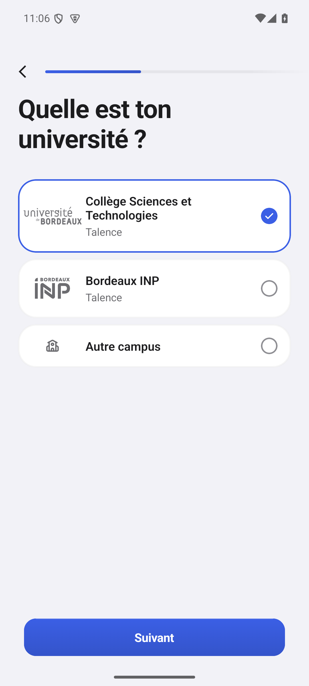

# Onboarding — premier lancement

Le parcours d'accueil, joué une seule fois : il choisit l'**établissement**, le thème, la langue et le
premier groupe favori, pour que l'application soit immédiatement utile à la première ouverture du
planning.

Implémentation en trois fichiers depuis le jalon [6-G](../phase-6/6-g-etablissements.md) :
[`WelcomeScreen.tsx`](../../src/features/Onboarding/WelcomeScreen.tsx) compose et enchaîne,
[`hooks/useWelcomeState.ts`](../../src/features/Onboarding/hooks/useWelcomeState.ts) porte l'état et
les cinq gestes, [`components/WelcomeSteps.tsx`](../../src/features/Onboarding/components/WelcomeSteps.tsx)
ne fait que rendre. L'étape d'établissement aurait porté le fichier unique au-delà de la limite de
lignes, et un écran qui compose n'a pas à porter le détail de cinq mises en page.

## Déclenchement

`RootContainer` ([`rootContainer.tsx`](../../src/shared/navigation/rootContainer.tsx)) rend le
parcours **à la place du `NavigationContainer`** tant que `SettingsManager.isFirstLoad()` est vrai.
L'onboarding vit donc **hors de toute navigation** : pas de pile, pas d'en-tête, pas d'onglets. Il
gère ses propres étapes par un simple compteur d'état.

Le drapeau `firstload` est persisté sous sa propre clé AsyncStorage, distincte de `settings`. Il est
remis à vrai par la réinitialisation depuis [Réglages](settings.md).

## Les six étapes — moins pour certains établissements

| Étape | Contenu | Effet |
|---|---|---|
| 1 | La vitrine : trois vraies cartes de UKit en relief, « Ton campus, en une seule app. » et le slogan de UKit (7-J, accueil refait) | — |
| 2 | « Clair ou sombre ? » sur deux aperçus d'une vraie journée, puis la langue, écrite dans sa propre langue | `SettingsManager.setTheme` / `setLanguage`, appliqués **en direct** |
| 3 | **Choix de l'établissement**, lu dans le catalogue — après un chargement parlant, le temps que le premier rafraîchissement réponde (quatre secondes au plus) | `basculerEtablissement(code)` ([`bascule.ts`](../../src/shared/etablissements/bascule.ts)), la même que les Réglages |
| 4 | **Compte universitaire**, proposé et sautable — avec le bouton « Tu es d'un autre campus ? » sous celui de connexion, qui ramène à l'étape 3 ; **« Suivant » et le retour sont bloqués tant que la connexion tourne** | `validateAndSave` du contexte de scolarité, ou « Suivant » |
| 5 | **L'emploi du temps** : groupes en rangées, le libellé en clair et le code dessous ([`partiesDuGroupe`](../../src/features/Onboarding/components/groupes.ts)), l'étape portant son cadre clavier, et le champ de recherche montant sous la barre de progression quand le clavier s'ouvre ; ou lien d'abonnement | favoris, ou `enregistrerLienEdt` |
| 6 | « C'est prêt. » et la première journée de cours des favoris — ou du lien d'abonnement, qui n'a pas de groupe —, qui arrive carte par carte ([`FinDuParcours`](../../src/features/Onboarding/components/FinDuParcours.tsx)) ; sans favori ou sans réponse de la source, le cercle qui se trace ([`TraitDeValidation`](../../src/features/Onboarding/components/TraitDeValidation.tsx)) | `setFirstLoad(false)` sur « Ouvrir mon planning » |

**Deux étapes disparaissent selon l'établissement**, et la règle est la même pour les deux : *on ne
pose pas une question sans réponse.* L'étape du compte s'efface chez une université qui ne publie
aucun portail ; celle de l'emploi du temps, chez une université qui n'en publie pas — et chez celle
dont le compte lit le lien d'abonnement (l'IUT de Bordeaux, lot 3) : l'étape du compte y répond, et
qui la passe trouve au Planning l'invitation à se connecter
([planning.md](planning.md#le-lien-lu-sur-le-compte)).

**L'établissement vient juste avant les groupes**, et l'ordre a été corrigé après coup : la
spécification du jalon [6-G](../phase-6/6-g-etablissements.md) le plaçait en première position, au
motif qu'il conditionne tout le reste. C'est vrai — mais ce « tout le reste » se réduit à l'étape des
groupes, alors que demander à quelqu'un de choisir son université **dans une langue qu'il n'a pas
encore choisie** met la charge au mauvais endroit. Mesuré en jouant le parcours, pas déduit.

**Le compte vient juste après l'établissement**, et avant l'emploi du temps (jalon
[6-J](../phase-6/6-j-compte-et-sources-par-etablissement.md)). L'ordre a été décidé **pour les autres
facs, pas pour Bordeaux** : ici le compte ne sert pas à obtenir l'emploi du temps, mais chez beaucoup
d'universités il *est* la porte, et le demander après aurait posé la question dans le mauvais sens.
C'est le formulaire de l'onglet Scolarité, tel quel. Il portait une sortie « Plus tard », un lien
discret ; la deuxième passe de 7-J l'a retirée, parce qu'elle doublait le « Suivant » du pied du
parcours, qui avance de même (review du 2026-11-05). Il se résout dès que le CAS
accepte (~13 s à Bordeaux) ; la lecture du dossier continue derrière, sans bloquer le parcours.

**L'étape de l'emploi du temps a deux contenus**, et c'est la **source** qui tranche, jamais
l'établissement : un choix de groupe quand il y en a à choisir, un champ de lien d'abonnement sinon
(voir [planning.md](planning.md#les-quatre-états-de-lemploi-du-temps)). Le formulaire de lien est rendu
**en place** : l'accueil vit hors de toute navigation, il n'a nulle part où pousser un écran.

La ligne de progression suit le nombre d'étapes — quatre à six —, recalculé à chaque rendu, pour qu'un changement
d'établissement à l'étape 3 ajoute ou retire une étape **tout de suite**.

La liste des établissements se rafraîchit **après** l'affichage : sa lecture est hors du chemin de
démarrage. **Elle ne s'y réabonnait pas**, contrairement à ce que ce paragraphe affirmait : l'écran
n'écoutait que le choix de l'utilisateur, et une installation neuve n'a vu que le Collège ST le
premier jour de la rentrée 2026 ([6.1-A](../phase-6/6-1-a-robustesse-scolarite.md)). Trois gestes y
répondent, parce que la cause avait trois étages :

- **le socle embarque les trois établissements publiés** à la date de la release, et un test le compare
  aux lignes de `supabase/etablissements.sql` ([`socle.ts`](../../src/shared/etablissements/socle.ts)) —
  une installation hors ligne voit donc la liste complète ;
- **l'étape se relit à chaque révision du catalogue** (`AppContext.catalogue`, bousculé par
  `rootContainer` quand la surcouche publiée change) ;
- **elle sait attendre le premier rafraîchissement** : un chargement parlant — « On récupère la liste
  des établissements… » — tant qu'il n'a pas répondu, plafonné à quatre secondes, après quoi la liste
  connue s'affiche et se complète si la réponse finit par arriver. Une base injoignable **a** répondu,
  par un échec : hors ligne, la liste s'affiche tout de suite. Le signal vit dans
  [`premierRafraichissement.ts`](../../src/shared/etablissements/premierRafraichissement.ts) — le
  canal « le catalogue a changé » existait, mais un premier rafraîchissement qui aboutit sans
  changement ne bouscule rien, et rien ne distinguait « pas encore répondu » de « répondu, rien de neuf ».

Le retour et la ligne de progression apparaissent à partir de l'étape 2, en haut.


**L'étape 1 montre l'application avant de lui poser une question**
([`VitrineDAccueil`](../../src/features/Onboarding/components/VitrineDAccueil.tsx), direction A de
l'[accueil refait](../phase-7/7-j-accueil.md)) : un cours, un restaurant et une bibliothèque flottent
en relief sur une lueur aux couleurs du logo. Le cours est la vraie carte du Planning (`CourseRow`) ;
les lieux sont faits des briques des cartes Campus, sans photo, parce que les cartes des onglets
montraient en grand le visuel de repli du Crous, sur la bibliothèque aussi. Les exemples sont de
vraies données des sources ([`exemples.ts`](../../src/features/Onboarding/components/exemples.ts)) :
une journée de Licence d'informatique, un restaurant et une bibliothèque de Talence. Les cartes montent l'une après l'autre puis la pile
respire ; sous « réduire les animations », tout est là d'emblée et rien ne bouge. Le U seul, puis
Fig. 01 avant lui, ont tenu cette place : un écran vide qui ne disait pas ce que fait l'application.

**Les questions sont posées en grand titre**, leurs réponses en tuiles
([`EtapesDeChoix.tsx`](../../src/features/Onboarding/components/EtapesDeChoix.tsx)) : le thème se
choisit sur deux aperçus d'une vraie journée de cours, dessinée à la largeur d'un téléphone puis
réduite à la tuile ; l'établissement, sur des tuiles qui portent le logo du catalogue. La
progression est une ligne fine en haut, à côté du retour, et le contenu passe dessous en fondu, comme
sous les titres de l'application ; le bouton est celui de l'application,
posé sur un fondu de la couleur de la page sous lequel le contenu s'efface.

**Le compte dit en tête ce que deviennent les identifiants** (`intro` de `ScolariteLoginView`, que
seul l'accueil passe) : chiffrés sur le téléphone, envoyés au seul service de connexion de
l'université — le fait de [PRIVACY.md](../../PRIVACY.md), pas une promesse de plus.

**La fin montre la première journée de cours**, aujourd'hui ou dans les six jours qui suivent : une
requête `fetchCalendarDay` par jour, l'une après l'autre, arrêtée au premier jour trouvé ou au premier
échec. On installe souvent l'application le week-end, et « aucun cours aujourd'hui » sur un écran vide
était la pire fin possible. Constaté au banc le samedi 7 novembre : un groupe de M1 en stage
(« Aucun cours cette semaine. », confirmé par le Planning), un groupe de L3 (« Lundi, 4 cours. »).
Un lien d'abonnement se demande sans groupe, et une journée entière (un jour férié) ne compte pas
pour un cours ; constaté au banc pour l'IUT le 2026-11-10 (« Aujourd'hui, un cours. »), où la fin
montrait jusque-là le cercle seul.

> **Capture attendue** — `onboarding-preferences.png` : l'étape 2, sélection du thème et de la langue.
>
> **Capture attendue** — `onboarding-fin.png` : l'étape 5, confirmation avant l'entrée dans l'application.



Chaque choix est appliqué **immédiatement**, pas à la fin : sélectionner le mode sombre à l'étape 2
repeint l'écran en cours. L'utilisateur voit ce qu'il choisit. Il n'y a donc pas d'état à valider —
seul `firstload` reste à basculer.

## Valeurs par défaut

Au montage, le parcours s'aligne sur l'appareil :

```ts
SettingsManager.setLanguage(languageFromDevice());        // fr / es / en
SettingsManager.setTheme(SettingsManager.getAutomaticTheme());  // Appearance.getColorScheme()
```

Un utilisateur qui traverse le parcours sans rien toucher obtient donc déjà la langue et le thème de
son téléphone.

## Sélection du groupe

C'est l'étape la plus élaborée. La liste complète des groupes vient de
`PlanningDataManager.getGroupList()`, chargée au démarrage
([donnees-et-persistance.md](../donnees-et-persistance.md)), et le parcours s'abonne à l'événement
`groupList` pour se mettre à jour si le chargement se termine après l'affichage.

**Le tri par année et semestre ne s'affiche que pour Celcat**, depuis le jalon
[6-J](../phase-6/6-j-compte-et-sources-par-etablissement.md). La table de fragments ci-dessous est une
convention de nommage **de Celcat Bordeaux**, et de rien d'autre : depuis que Bordeaux INP a un emploi
du temps (6-I), ses treize groupes s'appellent `ENSC 2A GR1` et aucun fragment ne les atteignait — la
liste restait vide sauf en choisissant « AUTRE ». La vraie question n'était pas *quelle table de
filtrage* mais **cette liste est-elle trop longue pour être parcourue** : Celcat publie plusieurs
centaines de groupes, un référentiel iCalendar en compte treize, qui tiennent à l'écran.

Le semestre en cours est présélectionné ([`semestreDe`](../../src/features/Onboarding/hooks/semestres.ts)),
au départ comme après un changement d'établissement : sans lui, la liste restait vide après le choix
de l'année, sans rien dire.

Le filtrage combine trois critères : **année**, **semestre** et **texte saisi**
([`groupesProposes`](../../src/features/Onboarding/hooks/groupesProposes.ts), testé sur des noms
réels). Un nom qui **écrit son niveau** (`L1` à `M2`) est rangé par lui, et par la parité d'un
semestre écrit (`S5` en automne, `S10` au printemps) ; sans semestre écrit, il paraît aux deux. Les
autres passent par la table de fragments d'identifiants (`50` pour la Licence 3 d'automne, etc.),
qui est une convention de sous-chaînes : mesuré le 2026-11-10 sur les 2 982 groupes de Celcat, elle
mettait `31ST750U M1 Professionnalisation` en Licence 3 (`50` dans `750`) et des `M2 … S10` en
Licence 1, et ne montrait `L3 IMSAT S5 - GR1` qu'en « Autre ». Le choix `AUTRE` ne filtre que sur le
texte.

**Une recherche ne demande pas l'année.** Sans année choisie, la liste reste vide — sauf si un texte
est saisi, qui cherche alors dans toute la liste : taper le nom exact de son groupe avant de choisir
l'année affichait « Aucun groupe ne correspond à cette recherche ».

L'affichage est plafonné à **10 résultats** ; au-delà, un message indique combien sont masqués et
invite à préciser la recherche.

> **Capture attendue** — `onboarding-groupes.png` : l'étape 4, avec une année et un semestre
> sélectionnés et une liste de groupes filtrée.

## Décisions de conception

**Hors navigation, volontairement.** Le parcours ne doit pas pouvoir être quitté par un geste de
retour ni apparaître dans un historique. Le rendre à la place du conteneur de navigation est le moyen
le plus simple d'y parvenir.

**Application immédiate des choix.** Voir le thème changer sous ses doigts vaut mieux qu'un aperçu.
Le corollaire est qu'abandonner le parcours en cours de route laisse les réglages déjà appliqués —
sans conséquence, puisque `firstload` reste vrai et que le parcours recommence.

**Les identifiants de groupe encodent l'année et le semestre.** La table `filterSeason` exploite cette
convention de nommage Celcat pour éviter à l'étudiant de parcourir plusieurs centaines de groupes. Ce
n'est pas un contrat : c'est une heuristique locale (voir les limites).

**Plusieurs groupes sélectionnables dès l'accueil.** L'étape 3 ajoute ou retire des favoris, elle
n'en choisit pas un seul : le planning agrégé est disponible immédiatement après l'accueil.

**Le contenu défile sous le pied, jusqu'au bas de l'écran.** Le pied (le bouton « Suivant »)
flotte, et chaque étape laisse sous elle de quoi remonter au-dessus de lui :
`useDegagementDuPied()` ([`stylesDuParcours.ts`](../../src/features/Onboarding/components/stylesDuParcours.ts)),
le dégagement des listes **plus la marge système du bas**, que le pied s'applique à lui-même. Sans
elle, au format de l'A8, la fin de la carte de connexion restait derrière « Suivant », « Plus tard »
compris (constaté sur le banc le 2026-11-05, 7-J).

## Vérifier

Le parcours ne se rejoue pas spontanément. Deux moyens de le retrouver : **Réglages → Réinitialiser
l'application**, ou réinstaller l'application.

- Traverser les quatre étapes sans rien changer : la langue et le thème doivent correspondre à ceux du
  téléphone.
- Réinitialiser l'application, réseau normal : l'étape établissement dit « On récupère… » puis propose
  les trois choix en moins de quatre secondes. Base injoignable (`SUPABASE_URL=https://127.0.0.1:1`,
  puis `expo start -c`) : les trois choix, tout de suite, depuis le socle.
- À l'étape du compte, toucher « Tu es d'un autre campus ? » : retour à l'étape établissement.
- À l'étape 2, changer thème et langue : l'écran doit se mettre à jour immédiatement.
- À l'étape des groupes, le semestre en cours est déjà choisi ; toucher une année suffit à remplir la
  liste. Changer de semestre : elle doit se réduire ; saisir du texte : elle
  doit se réduire encore ; dépasser 10 résultats : le message de résultats masqués doit apparaître.
- Sélectionner deux groupes puis terminer : le planning doit s'ouvrir sur l'agrégation des deux.
- Terminer sans choisir de groupe : le planning doit afficher son état vide, sans blocage.
- Utiliser le bouton retour à chaque étape.
- Réinitialisation complète depuis le menu de développement, interrupteur HORS LIGNE avant l'étape des
  groupes : l'étape dit **pourquoi** elle est vide et propose « Réessayer » ; rétablir le réseau puis
  réessayer remplit la liste (6.1-C).

## Limites connues

- **La table `filterSeason` est spécifique à des conventions de nommage observées.** Un changement de
  nomenclature côté université fait renvoyer des listes vides pour les combinaisons concernées, sans
  erreur visible. Le choix `AUTRE` reste le contournement.
- **Une connexion lancée bloque le parcours jusqu'à son terme** (6.1-A). « Suivant » et le retour
  sont désactivés tant que la carte du formulaire montre une session — soumission, barre,
  confirmation — parce qu'un échec doit se lire sur place et qu'un succès avance tout seul. Le prix
  est l'attente du parcours froid, une quarantaine de secondes à Bordeaux ; avant, un étudiant qui
  s'était trompé de mot de passe ne l'apprenait qu'en ouvrant l'onglet Scolarité. « Suivant » reste
  la sortie, tant que rien n'est lancé.

## Carte des fichiers

| Fichier | Rôle |
|---|---|
| [`WelcomeScreen.tsx`](../../src/features/Onboarding/WelcomeScreen.tsx) | l'enchaînement des étapes, leur nombre selon l'établissement, la bascule de `firstload` |
| [`hooks/useWelcomeState.ts`](../../src/features/Onboarding/hooks/useWelcomeState.ts) | l'état, les abonnements — résiliés au démontage depuis 6.1-C ; dont la révision du catalogue, l'attente plafonnée du premier rafraîchissement et l'état de la liste des groupes —, les valeurs par défaut système et les six gestes |
| [`hooks/groupesProposes.ts`](../../src/features/Onboarding/hooks/groupesProposes.ts) · [`groupesProposes.test.ts`](../../src/features/Onboarding/hooks/groupesProposes.test.ts) | les groupes proposés selon l'année, le semestre et le texte : le niveau écrit d'abord, les fragments ensuite, la recherche sans année — pur |
| [`components/WelcomeSteps.tsx`](../../src/features/Onboarding/components/WelcomeSteps.tsx) | l'en-tête du parcours (retour et progression), le compte, le lien iCal et la fin. Rend deux composants venus d'autres domaines — `ScolariteLoginView` et `LienEdtForm` — plutôt que d'en recopier une seconde version ([architecture.md](../architecture.md#dépendances-entre-features)) |
| [`components/StepGroupes.tsx`](../../src/features/Onboarding/components/StepGroupes.tsx) | l'étape des groupes et son pied : l'attente et l'échec de la liste — « Réessayer » relit la source —, puis le tri et la recherche (6.1-C) |
| [`components/stylesDuParcours.ts`](../../src/features/Onboarding/components/stylesDuParcours.ts) | le vocabulaire visuel du parcours — carte, pastille, dégagement du pied — sur les tokens et le thème courant |
