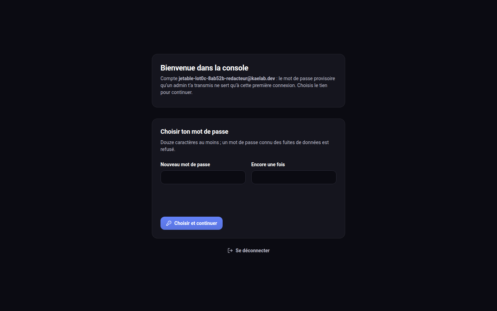
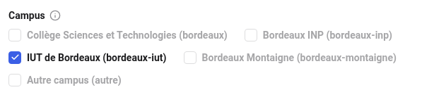
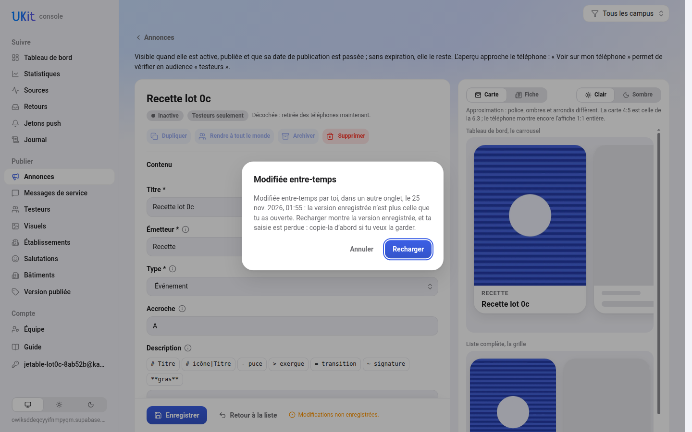

# Le guide de la console

La console, c'est l'endroit où l'on publie dans UKit sans passer par une mise à jour de
l'application : les annonces de la vie étudiante, les messages de service, et tout ce que les
téléphones relisent chaque fois qu'on ouvre l'application. Ce guide est écrit pour celles et ceux qui
publient sans être développeurs. La référence technique, elle, est [pilotage.md](pilotage.md).

Adresse : **https://kae-lab.github.io/UKit/**, sur un ordinateur. La console se lit sur un téléphone,
mais une annonce se compose sur un écran d'ordinateur.

## Se connecter

- **Un compte se crée sur invitation.** Un admin de la console t'invite et te donne un **mot de passe
  provisoire**, de vive voix ou par un message privé. Il ne sert qu'une fois.
- **À la première connexion**, la console ne montre qu'une chose : le choix de ton mot de passe. Douze
  caractères au moins ; un mot de passe connu des fuites de données est refusé, choisis-en un qui
  n'appartient qu'à toi.
- **Mot de passe oublié ?** Il n'y a pas de lien « mot de passe oublié » : demande à un admin, il t'en
  donne un nouveau provisoire.
- **Ton rôle** se lit dans la page **Compte**, en une phrase, et à côté de ton adresse, en bas de la
  navigation.

## Qui peut quoi

| Rôle | Ce qu'il fait |
|---|---|
| **Admin** | tout : les annonces, les messages de service et leurs notifications, le catalogue des universités, les bâtiments, les visuels, les testeurs, les retours, leurs captures, l'adresse que les gens y laissent et les réponses, les problèmes connus, et l'équipe |
| **Rédacteur** | crée, modifie, programme et archive les **annonces** des campus qui lui sont confiés, et lit tout le reste. Il ne supprime rien, et une annonce « pour tous les campus » reste un geste d'admin |
| **Lecteur** | lit toute la console, sans y écrire. Les adresses laissées dans les retours et leurs captures ne lui sont pas montrées |

Ce n'est pas la console qui décide, c'est la base de données : un bouton grisé n'est qu'un
avertissement, la règle s'applique de toute façon. En tête de chaque page, un bandeau dit ce que ton
rôle y permet.

## Publier une annonce

Tout se passe dans **Annonces**, puis **Nouvelle annonce**. À droite, l'aperçu montre ce que la carte
et la fiche donneront sur un téléphone, en clair et en sombre, et suit le champ que tu remplis.

1. **Contenu.** Le titre ; l'émetteur, le petit mot au-dessus du titre (« BDE Sciences ») ; le type
   (événement, information, bon plan, partenaire) ; l'accroche, qui sert de chapeau ; la description.
   La barre au-dessus de la description insère la mise en forme (titres de section, puces, exergue,
   signature) : pas besoin d'en retenir la syntaxe, l'aperçu la rend.
2. **Événement**, pour une annonce de type événement : le début, la fin et le lieu tel qu'on le
   cherche sur place (« Amphi A22, bâtiment A22 »). La fiche les montre sous le titre, avec **Ajouter à
   mon planning** : l'étudiant le retrouve dans son planning et, s'il synchronise son agenda, dans son
   téléphone. Un événement tient en vingt-quatre heures au plus ; une soirée peut passer minuit.
   Déplacer l'heure ou le lieu se reflète chez ceux qui l'ont ajouté ; archiver l'annonce, vider ses
   trois champs ou changer son type l'annule chez eux. Ne la fais donc pas expirer avant la fin de l'événement. Les faits,
   jamais l'appel (plus bas).
3. **Visuel.** Une affiche : elle est réduite et compressée toute seule avant l'envoi. Clique sur
   l'image pour poser le **point focal**, ce qui doit rester visible quand la carte la recadre ; le
   voile gris montre ce qui sera coupé.
4. **Cartes et ordre.** Les réglages par défaut conviennent presque toujours. Les **créneaux** mettent
   une annonce en avant à certaines heures (un bon plan du midi, de 11 h à 14 h, en heure de Paris).
5. **Lieu et action.** Pour le lieu, colle un point copié d'une carte (clic droit sur Google Maps) :
   la fiche proposera « S'y rendre ». Un bouton demande un libellé **et** un lien complet, qui commence
   par `https://`.
6. **Sondage**, si l'annonce pose une question : **Ajouter un sondage**, la question, deux à six
   choix, la date de clôture. Il s'affiche sous la description de la fiche ; chaque téléphone vote une
   fois, sans être reconnu, et voit les résultats après son vote. Ses résultats se lisent sous
   l'aperçu, une fois l'annonce enregistrée. Ne change pas les choix après les premières voix : un
   choix retiré perd les siennes. **Jamais sur un sujet politique** (plus bas).
7. **Publication.** Garde le statut **Brouillon** tant que tu travailles : personne ne le voit. Passe à
   **Publiée** quand c'est prêt. Une date de publication **dans le futur** programme l'annonce : elle
   apparaîtra toute seule à l'heure dite, et l'en-tête le dit (« Programmée, publiée le 3 octobre à
   11 h »). Une date d'expiration la retire toute seule.
8. **Ciblage.** Commence **toujours** par l'audience **Les testeurs seulement** (voir plus bas). Les
   campus : tes campus sont déjà cochés, et un rédacteur ne peut cocher que les siens. Laisse les
   versions et les plateformes vides, sauf consigne.
9. **Enregistrer**, en bas, ou **Ctrl+S** (**Cmd+S** sur Mac).

Dans la liste des annonces, ce qui sort de l'ordinaire se lit en petit à côté du titre : **Testeurs**
pour une annonce encore réservée aux testeurs, les **campus** qu'elle vise quand ce ne sont pas tous,
**Épinglée**, et le type quand ce n'est pas un événement. Rien à côté du titre veut dire : pour tout le
monde, sur tous les campus. Les autres listes suivent la même règle (le ciblage d'un message, un
établissement inactif). Une case cochée se lit « oui » en liste, une case vide ne s'écrit pas.

**Dupliquer** refait une annonce à partir d'une autre (la même affiche d'une semaine à l'autre) :
la copie naît en brouillon, et, pour un rédacteur, sur ses campus. **Archiver** retire une annonce des
téléphones en gardant sa trace et ses chiffres ; une annonce archivée se republie en changeant son
statut.

## La vérifier sur son téléphone

L'aperçu approche le téléphone, il ne le remplace pas. La preuve, c'est ton téléphone :

1. **Fais enregistrer ton téléphone comme testeur**, une fois pour toutes : dans UKit, **Réglages →
   À propos**, touche sept fois le numéro de version, onglet **Testeur**, **Copier**. Envoie cet
   identifiant à un admin, qui l'ajoute dans la page Testeurs.
2. Publie l'annonce en audience **Les testeurs seulement**, ou utilise **Voir sur mon téléphone**
   dans l'en-tête d'une annonce déjà publiée.
3. Ouvre UKit, onglet **Campus** : l'annonce est là, pour les seuls téléphones de testeurs. Si
   UKit était déjà ouverte, passe un instant sur une autre application puis reviens : les annonces se
   relisent au retour.
4. Quand tout est juste : **Rendre à tout le monde**.

## Travailler à plusieurs

Deux personnes peuvent ouvrir la même annonce. Si quelqu'un l'enregistre pendant que tu l'édites, rien
n'est écrasé : au moment où tu enregistres, un message dit **« Modifiée entre-temps »**, par qui et
quand. **Recharger** montre la version enregistrée ; ta saisie est alors perdue, donc copie d'abord ce
que tu veux garder, puis reporte-le.

Chaque écriture est enregistrée au nom de son compte, dans le **Journal** : qui a écrit quoi, et quand.

## Lire ses chiffres

Le **Tableau de bord** donne, à l'arrivée, quatre chiffres et leur évolution sur la semaine d'avant :
le **parc actif** (les téléphones qui reçoivent les notifications ; un minimum, puisqu'un téléphone
qui les a coupées n'y est pas), les **sessions**, les **ouvertures d'annonces** et les **échecs de
source**. Puis les sessions jour par jour, le parc par campus, version et plateforme, l'état des
sondes, les retours ouverts et les annonces visibles.

La page **Statistiques** va plus loin, en cinq onglets : la vue d'ensemble, les annonces, les sources,
les réglages et le rapport partenaire.

- **La période** se choisit une fois, en haut, et vaut pour tous les onglets : les 7, 28 ou 90 derniers
  jours, les flèches pour reculer ou avancer d'autant, ou **Dates** pour une plage précise. Chaque
  chiffre se compare à la période d'avant, de même durée, **quand elle est comparable** : la période
  d'avant doit commencer le 2 décembre 2026 ou après, sinon elle comptait encore la mise à jour vers la
  6.3 et l'évolution se lit « — ». Sur la semaine du tableau de bord, les évolutions reviennent le
  16 décembre. Le filtre de campus, en haut à droite, s'applique aussi.
- **Les téléphones des testeurs** sont exclus : **Avec testeurs** les remet, pour vérifier qu'un essai
  a bien été compté.
- **Une annonce** : dans l'onglet Annonces, clique sur son titre dans le classement. Les chiffres, la
  courbe et le détail par campus ne parlent plus que d'elle. Le **taux d'ouverture** rapporte les
  ouvertures aux fois où la carte a été vue ; grisé, il porte sur moins de vingt vues et ne se lit
  pas seul.
- **Le rapport partenaire** : choisis une annonce, ou un partenaire pour toutes ses annonces.
  **Exporter en CSV** donne un fichier qui s'ouvre dans Excel ou LibreOffice ; **Imprimer** ouvre
  l'impression du navigateur, où « Enregistrer en PDF » fait le document à envoyer. La définition de
  chaque chiffre est écrite en bas.

Une case qui compterait moins de cinq n'est jamais affichée, ni à l'écran ni dans l'export : elle se
lit « moins de 5 ». À cette taille, un chiffre peut désigner quelqu'un. Quand le total permettrait de
la retrouver par soustraction, une autre case se cache avec elle et se lit « masqué ». Les chiffres
commencent avec la version 6.3 de l'application : les téléphones restés sur une version plus ancienne
ne comptent rien.

## Ce qui ne se fait jamais

- **Supprimer au lieu d'archiver.** Une annonce archivée garde sa trace et ses chiffres ; une annonce
  supprimée les perd. Seul un admin supprime.
- **Partager une capture d'écran qui montre une donnée personnelle** : l'adresse laissée dans un
  retour, une capture envoyée par un étudiant, un nom, un numéro. Les retours restent dans la console.
- **Publier un essai pour tout le monde.** Un essai se fait en audience **Les testeurs seulement**,
  toujours ; « tout le monde », c'est plus de deux mille téléphones.
- **Publier un visuel dont on n'a pas les droits** : le logo d'une université ou d'une marque, une
  photo trouvée en ligne. Un logo affiché sur une annonce laisse croire que son propriétaire la
  soutient.
- **Un sondage sur un sujet politique.** UKit est un outil, neutre sur le fond : un sondage porte sur
  la vie du campus — un créneau, un lieu, un choix d'animation —, jamais sur une élection, un parti, une
  cause ou une prise de position. Dans le doute, on ne le publie pas.
- **Une annonce d'événement qui appelle.** Elle dit les faits — quoi, quand, où, qui l'organise —,
  jamais l'appel : ni « venez nombreux », ni « votez pour », ni « rejoignez le mouvement ».
  L'université et toutes les organisations étudiantes y ont le même droit, aux mêmes conditions, et
  le jugement porte sur la forme de l'annonce, jamais sur sa cause : UKit est un outil, neutre sur le
  fond.
- **Prêter son compte.** Chaque compte est personnel, et tout ce qu'il écrit est enregistré à son nom.
  Pour quelqu'un de plus, un admin l'invite.

## Pour les admins

- **Inviter** : **Équipe → Inviter quelqu'un**, l'adresse, le rôle et, pour un rédacteur, ses campus
  (aucune case : tous). À l'enregistrement, le mot de passe provisoire s'affiche **une seule fois** :
  transmets-le de vive voix, ou par un message privé.
- **Changer un rôle ou des campus** : ouvre la ligne, change, enregistre. Le changement vaut dès la
  requête suivante.
- **Mot de passe oublié** : **Nouveau mot de passe provisoire**, sur la ligne de la personne. L'ancien
  cesse aussitôt de fonctionner.
- **Révoquer** : les droits sont coupés à la requête suivante, puis le compte est supprimé ; le journal
  garde l'adresse et tout ce que ce compte a écrit. On ne se révoque pas soi-même, et la console garde
  toujours au moins un admin.
- **Les messages de service** s'adressent à tout le parc : une information, un avertissement, un
  incident. **Notifier** envoie une notification aux téléphones visés, **une seule fois** : relis avant.
- **Les retours** se reclassent (nature, état, note). L'adresse laissée s'affiche au clic,
  **Afficher l'adresse**, et ne se recopie nulle part ailleurs. Depuis la 7.0, la plupart arrivent de
  l'application (**Source : Application**) : leur fiche montre ce que l'étudiant a laissé joint, ses
  captures et, s'il l'a demandé, la case **Répondre** — ce que tu y écris, il le lit dans « Mes
  retours », avec l'**état** que tu choisis (reçu, en cours, traité, clos). Une réponse part telle
  quelle : relis-la, elle ne se corrige pas, elle se retire. Les captures s'effacent seules trente
  jours après la clôture.
- **Les problèmes connus** : ce que l'application montre avant d'envoyer un bug. Un titre que
  l'étudiant reconnaît, sans jargon, publié pour la plateforme touchée ; à côté, les « Moi aussi » et
  les appareils, et les détails reçus, à reprendre pour mieux formuler. **Corrigé**, avec la version,
  le garde un mois dans l'application ; **Clos** le retire.
- **Les idées** (**Communauté → Idées**) : la boîte à idées de l'application. Une idée retenue d'un
  retour s'y écrit **reformulée**, jamais recopiée, sans rien qui désigne son auteur ; **Proposée**
  la publie, **En cours** le dit, **Livrée** demande la version, que les téléphones qui l'ont soutenue
  annoncent ; **Close** la retire. À côté, ses « Moi aussi » et les détails reçus, comme pour un
  problème connu.
- **Les testeurs** : ajoute les téléphones de l'équipe (un identifiant, un nom).
- **Les signalements** : ce que les étudiants signalent sur les restaurants, les bibliothèques et les
  bâtiments, lieu par lieu, avec ce que l'application en montre. **Masquer** retire une voix de
  l'application (**Rétablir** la rend) ; c'est le seul retrait, une voix ne se supprime pas.
  **Bloquer l'appareil** masque toutes ses voix encore valables et refuse ce qu'il écrira : on le
  désigne par l'un de ses signalements, sa clé ne s'affiche jamais. **Rendre officiel** publie ce que
  disent les étudiants comme un état officiel, qui passe devant eux dans l'application ; un état
  officiel se publie aussi à la main, jusqu'à un jour choisi, et se retire. Un signalement abusif se
  masque ; un appareil qui en abuse se bloque.

Pour réparer un compte admin, il reste une commande sur le poste du développeur :
[`supabase/README.md`](../supabase/README.md#la-console-et-son-équipe).
